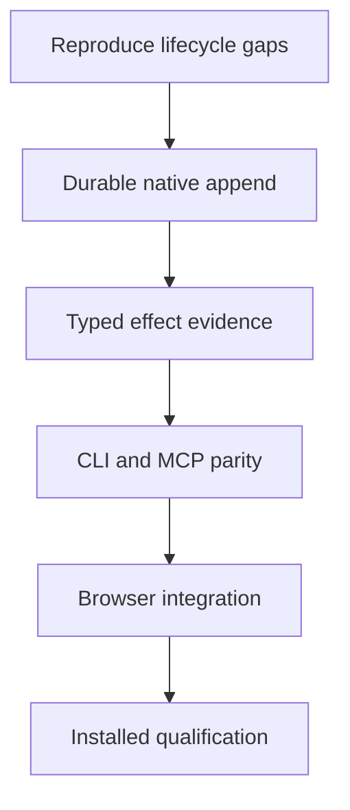

# Plan 1: One durable execution core

Proposed October 28, 2026 against local `main` at `5d494c6`. This is a design alternative. No runtime, tests, policy settings, dependencies, or applications were changed to produce it.

Footwork would become an execution library whose guarantees hold across its entry points. An agent, a person, and Jev could choose actions differently while relying on the same identity checks, authorization accounting, operation journal, and evidence. The strategic bet is that consistent execution semantics are the most valuable foundation for adding useful capabilities.

This plan invests first in the runtime contract. It differs from a workflow product that optimizes one job, a verifier sidecar that observes another executor, an operator console that improves human interaction, and a research lab that sells or distributes evaluation capability. Its principal opportunity cost is postponing visible feature breadth and first-use polish while converging existing implementations.

The intended caller experience is the following proposed API, not an existing interface:

```python
observation = await session.observe()
attempt = await session.perform(proposal, observation=observation.id, token=token)
result = await session.reconcile(attempt.id)
```

The caller receives separate dispatch, observed-effect, persistence, and task-fulfillment facts. Repeating a token collects the recorded operation; it does not repeat an uncertain input. A caller cannot transfer authorization by changing a target label or reusing an old observation.

The current source establishes three concrete reasons for this direction. The operator consumes a grant before dispatch, then calls the bridge before constructing and saving its pending record ([session.py:963](/Users/thomasmain/projects/footwork/jevdual/python/jevdual/session.py:963), [session.py:989](/Users/thomasmain/projects/footwork/jevdual/python/jevdual/session.py:989)). Grant consumption independently rewrites a JSON file ([grants.py:115](/Users/thomasmain/projects/footwork/jevdual/python/jevdual/grants.py:115)). Some effect evidence is recovered from presentation strings ([completion.py:32](/Users/thomasmain/projects/footwork/jevdual/python/jevdual/completion.py:32)). These are observed code structures; the resulting crash and concurrency failures remain hypotheses until reproduced.

The capability service already persists intent before dispatch and checks token reuse and unresolved operations ([service.py:42](/Users/thomasmain/projects/footwork/jevdual/python/jevdual/capability/service.py:42)). Its append-specific validation and recovery cannot simply be advertised as a universal executor. The October 28 notebook also limits the recent repair to observation and diagnostic evidence; observation of Muse did not qualify arbitrary application effects ([repair notebook](/Users/thomasmain/projects/footwork/jevdual/docs/notebook/2026-10-28-native-observation-repair.md)).

The proposed architecture is a Python modular monolith. A small `execution/` package would own domain records, transactional storage, authorization reservations, and lifecycle transitions. Surface adapters would own observation and dispatch mechanics. Evidence producers would emit typed facts; renderers would generate human text from them. Existing planning loops would retain their decision-making roles. Browser-use private hooks would remain isolated and pinned rather than becoming domain dependencies.

The calling host owns overall task progress and schedules subsequent work. Footwork retains custody of admitted operations and their owed results. A separately owned execution worker may finish its admitted operation; absent a caller, the workflow waits. This introduces no resident planner or automatic scheduler. Authority covers mediated operations and cannot constrain a same-user host's outside tools. The October 8 architecture hypotheses are historical proposals; this plan's first slice must earn its own evidence.

The first records are `SurfaceBinding`, `Observation`, `Proposal`, `AuthorizationReservation`, `Attempt`, `Evidence`, and `Result`. They carry resource incarnation, generation, producer, schema version, and validity limits. The store groups intent and grant reservation in one transaction. It commits a dispatch-start marker before calling an adapter, preserving the unavoidable uncertainty window between database state and an external GUI effect. Only qualified no-send evidence permits releasing a reservation as unused. Unknown attempts block conflicting successors.



| Milestone | Ownership and proposed changes | Acceptance and dependency |
|---|---|---|
| 1. Durable native append | Execution owner: proposed `python/jevdual/execution/`, operator append seam in `session.py`, grant storage in `grants.py`. Test owner: `tests/test_session_scenarios.py` and the simulated native fixture. | First commit the diagnostic prediction. Reproduce the post-dispatch/pre-save gap, then implement durable append. Crash at each boundary must retain a recoverable attempt or established no-send result. Conflicting writers must serialize or refuse. |
| 2. Typed effect evidence | Evidence owner: `receipts.py`, `completion.py`, native field readback producers, and a versioned compatibility reader. | Depends on attempt identity from milestone 1. Field readback contains producer/resource/attempt identity. Changing display wording cannot change the verdict. A later edit invalidates current-state support. |
| 3. Public caller parity | Integration owner: `session.py`, `agent_cli.py`, `capability/service.py`, and proposed Python SDK exports. | Depends on durable attempts and typed evidence. The same scoped append proposal has equivalent dispositions, reservation use, and evidence through CLI, MCP, and SDK. Preserve the MCP capability's narrower resource authority. |
| 4. Additional adapters | Surface owner: `desktop.py`, `browser_driver.py`, then `agent.py`; compatibility owner: `tests/contract/`. | Migrate one operation family per reviewable change. Click, replacement, save, and browser actions earn separate adapter checks. An adapter unable to establish a recovery fact returns unknown. Existing upstream contract tests remain required. |
| 5. Installed adoption | Release owner: existing bundle and installed-trial scripts; documentation owner: `docs/unified-cli.md` and current capability matrix. | Depends on the chosen supported adapter set. An installed consumer outside the checkout completes one frozen scoped workflow, survives one interruption, and produces independently checked output. Report host and permission limitations. |

The first reviewable implementation is milestone 1 restricted to native append. Its review must include the before-fix scenario failure, operation transitions, reservation rules, and restart behavior. General command rearrangement is unnecessary for that change. Forecasts remain unavailable until this slice exposes the adapter and migration cost.

Proposed acceptance targets are zero additional dispatches for replay of a recorded token, zero new conflicting dispatches while an attempt is unknown, zero accepted stale grants, and unchanged existing secret-redaction and authorization behavior in the relevant scenarios. A crash test establishes only its injected boundary; it does not establish universal power-loss safety. Model-backed measurements require a separately preregistered frozen experiment and explicit spend scope. Threshold tuning cannot substitute for missing evidence.

Migration uses a new versioned store for new sessions first. Existing JSON/JSONL sessions remain readable through a compatibility view. Any later conversion preserves the originals, records provenance, and marks unresolved historical dispatches unknown; conversion cannot invent evidence. Only one writer owns a session during migration. Rollback routes new sessions to the previous implementation while leaving new-format sessions available to a compatible reader; an unresolved attempt is never replayed through the old executor.

Evidence schema work and adapter inventory can proceed in parallel after the core records are agreed. Changes to grant accounting, storage, and the append caller must serialize. Completion migration follows evidence production, not the reverse.

The main disconfirming result would be that two callers cannot use the lifecycle without surface-specific branching throughout the core. In that case, retain shared records and journal primitives but keep adapter-specific services. If simulated crash probes fail to reproduce the suspected exposure, revise the diagnosis before designing its repair. If parity requires weaker authorization or optimistic recovery, stop that migration. If the first slice produces no reliability gain and substantial new integration burden, choose the narrower workflow alternative.

This plan authorizes no implementation. Later work needs the repository's committed notebook predictions before substantive tests, normal review, and applicable explicit authorization for paid runs, network installation, real application mutations, publication, or merge. A source change becoming reviewable is distinct from an installed workflow earning qualification.
