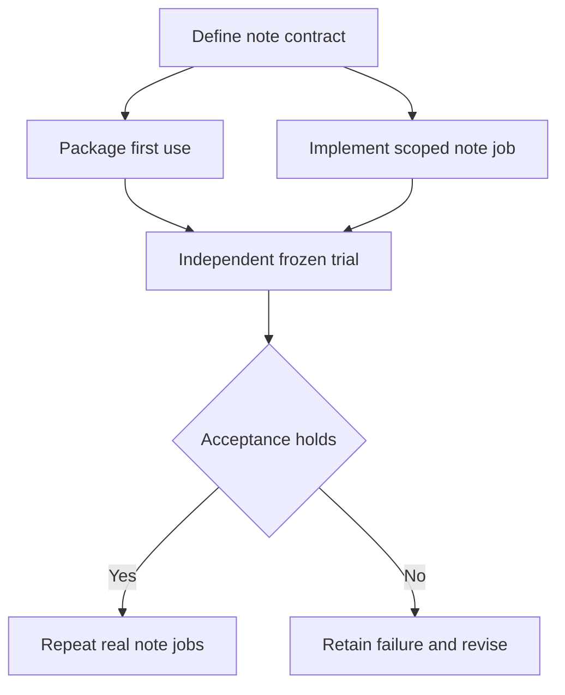

# Plan 2: A polished source-to-note workflow

Proposed October 28, 2026, against `5d494c6`. This is an alternative investment strategy: ship one useful, repeatable workflow and let adoption determine subsequent capabilities. It is not an additional phase of the shared-core plan. No implementation, experiment, installation or live operation accompanies this document.

The product is **“save this exact browser excerpt in my research note, with its source and a checked file.”** A host agent keeps the conversation and selects a passage from an authorized observation. Footwork packages that passage, source URL/title and capture time into a plain-text note, appends through a scoped TextEdit document, saves, and reports separately what was observed, transferred and persisted. Exact quotation makes the first outcome independently checkable without adding summarization quality to the experiment.

The proposed caller supplies an approved source, a passage from its current observation, and a new destination inside an approved folder. A job advances through `source_bound → excerpt_selected → destination_ready → appended → saved → verified`. Those are proposed workflow states, not existing public commands. The host sees the next useful move, an operation ID and any unresolved condition; it does not assemble process IDs or infer whether “Save” worked.

**Evidence and hypothesis.** The October 12 installed trial demonstrated one browser-to-TextEdit append with exact accessibility readback, durable reporting and cleanup. It explicitly did not establish saved-file persistence, other hosts or cold setup ([installed report:5](/Users/thomasmain/projects/footwork/jevdual/results/installed-agent-release-20261012-v2/report.md:5)). The independent U2 attempt recorded a valid denied-permission baseline but failed its first post-grant fixture; later development success did not regrade that attempt ([U2 report](/Users/thomasmain/projects/footwork/jevdual/results/u2-independent-onboarding-20261011-v1/report.md:17), lines 17–29). The latest native repair establishes capture binding on the tested host, including Muse observation, rather than a general workflow qualification ([notebook](/Users/thomasmain/projects/footwork/jevdual/docs/notebook/2026-10-28-native-observation-repair.md:35), NOS1).

Current code requires a loopback HTTP source and preconfigured process/window identities ([backend.py](/Users/thomasmain/projects/footwork/jevdual/python/jevdual/capability/backend.py:40), lines 40–63); capability reports expressly decline persistence claims ([contracts.py](/Users/thomasmain/projects/footwork/jevdual/python/jevdual/capability/contracts.py:65), lines 65–85). Thus this proposal requires new scoped source binding and artifact verification. The hypothesis is that a modest extension of the existing capability can deliver useful research notes with low first-use friction. Neither demand nor sufficient reliability is established.

**Product and architecture.** Add a small workflow module above the existing capability service. Its job manifest binds one source observation, exact passage bytes, destination path, append/save operation IDs and final artifact evidence. Keep recipes versioned and explicit. Begin with one selected public HTTPS page in Footwork's dedicated Chrome and one newly created plain-text TextEdit document. Qualify redirects, navigation and origin scope before offering remote pages; the existing loopback route remains a separately identified fixture mode. Accounts, personal browser profiles, rich text, arbitrary applications and automatic extraction remain later choices.

The installer offers a workflow-specific core bundle and host registration using the existing bundle machinery ([build_agent_bundle.py](/Users/thomasmain/projects/footwork/jevdual/scripts/build_agent_bundle.py:72), lines 72–104). Its walkthrough identifies the responsible permission host, creates an owned demonstration and reports concrete blockers. The workflow uses durable capability operations; it does not route mutation through the general operator's less durable command path. Saving gets its own qualified operation and evidence record. Existing native save readback is a useful starting point, not proof that the new workflow is correct ([native.py](/Users/thomasmain/projects/footwork/jevdual/python/jevdual/native.py:1231), lines 1231–1243 and 1312–1343).

1. **Define a useful, checkable note contract.** Product ownership: proposed `docs/source-note.md`, one example manifest and an experiment preregistration under `docs/experiments/`. Specify exact byte formatting, citation provenance limits, unique destination creation, source-change behavior, expected stops and the artifact oracle. Use the user's own volunteered recurring note task to test relevance. The smallest reviewable change is this contract plus consumer instructions and expected receipts; it contains no unimplemented runtime stubs. Commit the experimental prediction before any resolving trial.

2. **Make installation and scope selection understandable.** Packaging ownership: `scripts/build_agent_bundle.py`, `capability/setup.py`, a proposed `scripts/source_note_setup.py`, and consumer documentation. Reuse exact source pins and isolated environments. Replace fixture-only manual IDs with explicitly selected resource discovery. Add denied-permission, missing-Chrome, ambiguous-window and occupied-destination scenarios. Packaging and workflow implementation may proceed in parallel once the contract is fixed. Their public input/output schema changes serialize through one owner.

3. **Implement the staged note job.** Runtime ownership: proposed `python/jevdual/workflows/source_note.py`, with bounded changes in `capability/backend.py`, `contracts.py`, `service.py` and artifact checking. Bind the exact excerpt to its observation, preserve existing note bytes, and admit append and save as separately journaled operations. Verify the destination through file readback and an owned close/reopen check during qualification. Publish a workflow receipt without changing the old report's historical-only meaning. Scenario tests cover changed source, wrong document, duplicate request, conflicting edit, save refusal and lost reply.

4. **Qualify first use, then repeated value.** Qualification ownership: a new frozen installed trial script and corresponding `results/` package. Give an independent agent only the public bundle/instructions. Separate an already-permitted-host trial from an observed denied-to-granted permission journey; record every attempt. After technical acceptance, collect repeated user-selected jobs and compare intervention and elapsed time against that user's ordinary method. Generalize only the next capability demanded by those jobs. Forecast is unavailable until the save and source-binding spikes establish scope.

**Proposed acceptance scorecard.** These are targets, not measured results: zero wrong-destination writes, duplicated appends, overwritten prior content or unsupported saved claims; exact passage/citation bytes and a matching reopened artifact for every claimed success; zero author coaching or supplied internal IDs during independent first use; every interrupted attempt either reconciled from qualified evidence or retained as unknown. Record setup actions, human interventions, elapsed time and completion coverage for every case. Predeclare the task sample and comparison rule before measurement; a small zero-error sample does not establish universal reliability.

**Recovery and migration.** New recipe versions create separate job directories and schema versions. Old capability sessions keep their old contracts. Existing destination files and symlinks refuse creation. An uncertain append blocks save/continuation until reconciliation; requesting a new token is not recovery. Preserve failed runs and immutable release artifacts, and roll back by selecting the previous recipe/bundle for new jobs. No automatic session conversion or reexecution occurs.

**Stop or pivot.** Stop expansion on any wrongly certified effect. If source selection or save identity cannot be qualified, reduce scope explicitly rather than calling the fixture product-ready. If repeated users prefer direct copying because setup/review dominates, reconsider the workflow or the premise before investing in more adapters.

This plan sacrifices broad platform development to obtain adoption evidence quickly. It does not require a universal execution-core migration, a verifier-only SDK, a persistent operator console or a general benchmark product. The risk is optimizing a narrow task that users rarely need. Future implementation must follow committed notebook predictions; dependency downloads, paid trials, permission changes, real source/destination access and publication each require applicable user authorization. This plan supplies none of those approvals.
