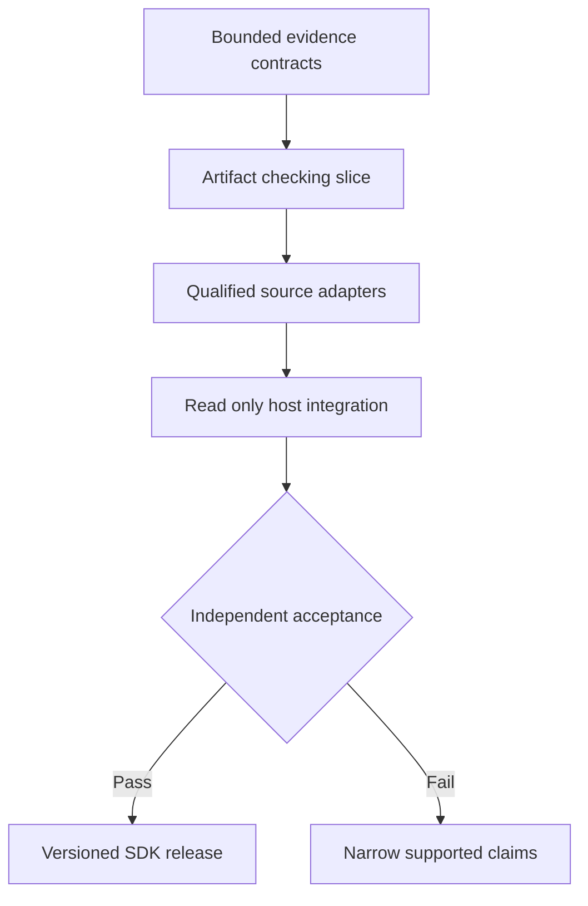

# Plan 3: an evidence and verification SDK for agent hosts

Proposed October 28, 2026, against local `main` at `5d494c6`. This is a competing product direction. Only this plan was written; no implementation, test, provider call or live observation was performed.

**Thesis.** Make Footwork the evidence checker an existing agent invokes before publishing a result. The host retains its planner and driver. Footwork supplies bounded observations, deterministic artifact checks, qualified semantic assessments and precisely scoped report rendering. The primary deliverable is a small Python library and local process interface that can be adopted without installing browser automation or taking over execution.

The product promise is: “Show which parts of this claim the available evidence supports, when they were observed, and what remains unknown.” Its distinguishing bet is that hosts will adopt useful verification independently of Footwork's executor. That demand is a hypothesis requiring an integration trial.

**What the repository supports.** [Artifact checking](../../../python/jevdual/artifacts.py#L42) already compares current bytes with a digest-bound expected source, without a model call or session provenance. [Capability report validation](../../../python/jevdual/capability/completion.py#L86) reads a complete bounded task ledger and renders historical operation outcomes. Its [A2 report](../../../results/operation-completion-20261010/report.md) explicitly distinguishes a retained receipt from matching external text: matching content without a receipt leaves the operation unknown. These are strong initial building blocks.

The existing general verifier has broader coupling: [verify.py](../../../python/jevdual/verify.py#L20) imports TypeSafe, policy, menu and agent-trajectory machinery; [completion.py](../../../python/jevdual/completion.py#L32) derives some facts from receipt prose. The [distribution metadata](../../../pyproject.toml#L16) installs browser-use and CUA even for consumers interested only in checking evidence. Extraction therefore requires explicit dependency and semantic boundaries. The [D1 report](../../../results/d1-v2-dev-20261008/report.md) provides evidence against substituting another semantic backend under unchanged thresholds; this direction keeps existing Jev semantics where qualified.

**Intended caller experience.** This is a proposed API, not an available command:

```python
result = evidence.check(
    claim=ArtifactEquals(path=destination, expected_digest=digest),
    source=LocalExpectedFile(path=expected_source),
)
host.publish(evidence.render(result))
```

The result names the predicate checked, source adapter, resource identity, observation interval, digest, check version, outcome and limits. A successful byte-equality check supports only current equality to the declared source. It says nothing about who created the file, whether the source was approved, or whether the broader task was correct. Other explicit checks cover answer support in a captured observation and historical operation claims backed by an authorized journal reader.

**Architecture and trust boundaries.** Introduce a dependency-light `footwork_evidence` source package beside `jevdual`, with contracts, deterministic checks and renderers. Optional adapters supply local files, Footwork journals, captured DOM/AX observations and Jev assessments. CLI JSON and an optional read-only MCP sidecar call the same functions. No driver dispatch, automatic repair or approval consumption belongs in this package.

Treat imported transcripts, screenshots and host assertions as supplied evidence with declared provenance. A hash establishes byte identity, not authenticity. Only a configured adapter may classify an observation as directly collected, and its freshness and coverage remain explicit. Separate current-state predicates, historical events and answer support; do not convert one into another. Preserve unknown historical execution after interruption. This is not containment of a malicious same-user process, and a renderer cannot force an arbitrary host to publish its output. A qualified host integration must actually use the validated result at its publication boundary.



**Milestone 1 — prove the smallest useful slice.** The contract owner specifies `ArtifactEquals`, outcome variants and provenance fields under proposed `python/footwork_evidence/`; the packaging owner defines a dependency-light wheel build under `scripts/`. The first reviewable change extracts bounded file equality from `artifacts.py`, keeps its existing caller compatible, and supplies one SDK example and contract test module. Preserve symlink, mutation and size refusals. Completion requires an isolated install that imports and checks a fixture without browser-use, CUA, Rust or provider access. This checks implementation independence, not customer demand.

**Milestone 2 — add qualified evidence sources.** The evidence owner adds explicit adapters for the existing private journal reader and a versioned observation envelope. Refactor prose-derived evidence only where needed by these adapters; do not migrate execution storage. Journal ingestion reads the configured database directly rather than trusting a host-supplied “complete snapshot.” Preserve full-ledger overflow refusal, operation-set equality, historical scope and current-state invalidation. The semantic owner subsequently wraps existing Jev claim checks with model, prompt and settings identity. Malformed or unavailable assessments produce an explicit unavailable outcome. Milestone 1 contracts must stabilize first; deterministic and semantic adapter work can then proceed independently.

**Milestone 3 — integrate one external driver host.** The integration owner builds a local example under proposed `examples/evidence-host/` and a bounded JSON CLI. The host performs an owned fixture action through its existing driver, asks the SDK for permitted readback, and publishes the returned assessment. Supply a separate case in which an imported transcript is insufficient to prove execution. An optional MCP wrapper follows only if the selected host needs it; it adds no mutation tools. Packaging and adapter conformance gate this work.

**Milestone 4 — test adoption and release a narrow contract.** Preregister an independent, documentation-only integration task using fresh development cases and a sealed acceptance set. Measure integration interventions, supported-claim coverage, incorrect endorsements and latency added per checked result. Freeze the SDK and example before the acceptance trial. Release only the claim families that pass; publish exact source/wheel identity and evidence scope. Version fields and adapters rather than promising universal task verification.

**Proposed acceptance criteria.** These are targets, not observed results: zero unsupported endorsements in the frozen adversarial set; all unknown-history, stale-source, foreign-resource, omitted-operation and changed-file cases remain unknown or refused; wording-only renderer changes never alter outcomes; an independent host completes the documented integration without source edits; positive coverage meets the preregistered task-family threshold. Report denominators and uncertainty. Zero observed errors in a small set does not establish a universal error rate.

**Disconfirmation and opportunity cost.** Pivot if useful claims require adopting Footwork's entire executor, if the independent host cannot supply adequate resource identity, or if false refusals make the accepted task family impractical. If consumers only need artifact equality, ship that narrower utility. Choosing this direction postpones generic execution unification, turnkey workflow expansion, the human operator console and research-lab productization. It offers easier embedding but relinquishes control over actions, retries and host behavior.

**Migration, recovery and authorization.** Keep existing imports and outputs behind compatibility adapters until frozen-corpus equivalence holds. Semantic differences require a new check version, with no regrading of old runs. Preserve original journals; the SDK reads them without owner takeover or startup recovery. Interrupted checks return unavailable and can be repeated read-only; external mutations are never replayed. Future substantive tests require committed notebook predictions and experiment preregistration under [CONTRIBUTING.md](../../../../CONTRIBUTING.md). Implementation selection, dependency downloads, provider spending, live-resource trials and publication remain future authorized work. No delivery-time forecast is claimed.
