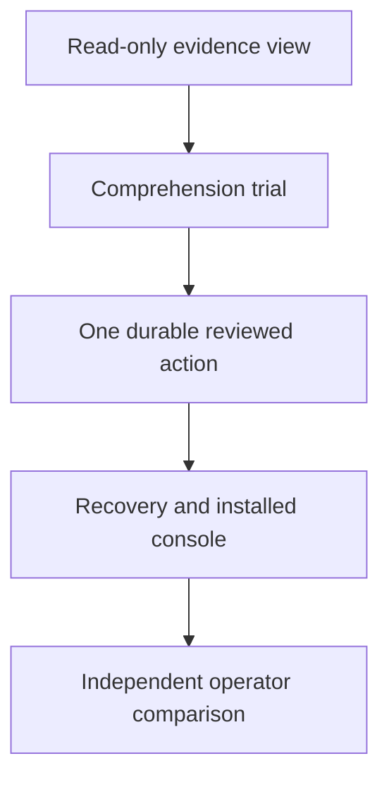

# Plan 4: an attended operator console

Proposed October 28, 2026 against `5d494c6a22921d092e67399badce708e8418bf2a`. Design only; no runtime change or experiment accompanies this plan. Delivery estimates are unavailable.

The product is a local workbench for a person supervising computer actions. Its primary outcome is an operator who can identify the intended target, understand exactly what is authorized, and resolve uncertain results without reconstructing shell logs. The person chooses the next step. Footwork supplies observations, guarded execution and evidence.

An initial user story: “Show the selected TextEdit document and proposed appended text. Let me approve that exact insertion, then show the independently observed change. If something interrupts it, explain what is known before I decide what follows.” An agent may draft proposals, but cannot approve them through this console.

Current evidence supports a starting point. [Native inspection](../../../results/visual-inspection-20261008/report.md:3) already produces a screenshot, exact target outline, manifest and static preview; its qualification used an owned AppKit fixture. [Current implementation](../../../python/jevdual/session.py:588) rejects unsupported browser geometry, secret-bearing capture, changed targets and truncated or degraded observations. A partial native AX projection can still support numeric-target inspection with its coverage limit recorded; label selection requires a complete observation. That demonstrates mechanics, not operator comprehension. The [latest repair notebook](../../notebook/2026-10-28-native-observation-repair.md:36) establishes installed native observation while limiting its claims about actual task outcomes.

Two other source facts constrain a console. [CLI JSON](../../../python/jevdual/agent_cli.py:360) explicitly leaves effect verification unasserted. [Receipts](../../../python/jevdual/receipts.py:9) describe visible change separately from delivery. The UI must preserve those distinctions. The hypothesis is that presenting source, proposal and result together reduces wrong selections and recovery effort. This needs an independent usability comparison.

The proposed interface has three connected views:

| View | What the person sees and controls |
|---|---|
| Selected resource | App/document identity, capture time, readable AX text, screenshot when permitted, coverage limits and Refresh. Selection is explicit; no whole-desktop surveillance. |
| Proposed change | Highlighted target, exact arguments, before/expected-after text, required result, delivery posture, Approve once and Reject. Editing arguments invalidates approval. |
| Evidence timeline | Observation, approval, attempt, delivery, readback and completion records. Separate labels show “input delivered,” “text observed,” “saved file checked,” or “unknown.” Recovery offers qualified inspection and Stop. |

Keyboard navigation, readable status text and accessible contrast are acceptance requirements. Color alone conveys no result. Visual probabilities live in optional detail and confer no action authority. When screenshots are withheld, the view explains that limitation and offers the available text evidence.

Implement a small local web UI served by a Python process launched explicitly for one private session. Use bundled HTML/CSS/JavaScript and a typed console adapter; importing the UI must not start a driver. The process binds loopback only, requires a per-launch token and same-origin requests, escapes observed text, limits artifact access to manifest-listed session files, and exposes fixed operations rather than arbitrary commands. It runs while the operator has the console open. Closing the UI stops new admissions; a supervised worker may settle only an already-admitted operation. Restart begins in recovery mode, with no autonomous task progression.

Approval records bind resource identity, observation generation, target, exact arguments, posture and expected result. Immediately before dispatch, reobserve and revalidate the approved evidence; relevant state or pixel changes invalidate approval and demand a new review. A saved screenshot hash alone cannot establish current pixels. The [grant implementation](../../../python/jevdual/grants.py:26) supplies useful argument/value binding, but reviewed visual execution is additional work. Console controls cannot constrain other applications or a same-user caller’s outside tools.

1. **Read-only console.** UI ownership: proposed `python/jevdual/console/assets/`; adapter ownership: proposed `console/projection.py`, with narrow extraction from `session._inspection_preview`. Create a versioned projection from validated manifests and structured receipt fields. Missing fields remain unknown; avoid parsing stdout. The first reviewable change is an offline rendered fixture showing fresh, stale, withheld and uncertain states, with all execution controls disabled. Check escaping, accessible navigation and artifact bounds. This can start without an execution-core refactor.

2. **Comprehension trial and one reviewed append.** First preregister whether operators correctly distinguish reviewed intent, delivered input, observed text and persistence. If comprehension warrants progression, add proposed `console/actions.py` and focused session integration for one TextEdit append. This narrow path needs durable intent before dispatch, a single-use approval, serialized session access and typed readback. The [existing operator path](../../../python/jevdual/session.py:985) saves pending state after dispatch; wrapping it unchanged would inherit that crash window. Reuse bounded ideas from the [capability journal](../../../python/jevdual/capability/journal.py:1), without assuming its append backend is a generic executor. Add compatible session ownership checks so legacy writers refuse a console-owned session. External edits still require revalidation.

3. **Recovery and installation.** Own proposed `console/server.py`, console launch routing in `cli.py`, and installed-resource checks. Double-clicking Approve must reuse the same attempt identity. A disconnect after dispatch must retain the attempt and show uncertainty until supported evidence resolves it. Reconnecting never performs the append again. Exercise close-before-dispatch, close-after-dispatch, delayed readback, changed document, exhausted grant and denied permission. Add one console entry to the existing bundle, then test it outside the checkout.

4. **Independent comparison and scope decision.** Own a preregistered experiment plus operator task fixtures and a report. Compare current CLI with the console on unfamiliar native selection and recovery cases, including impossible tasks. Primary measure: operator effort per correctly completed task; retain all failures and total time. Expand only into a second explicitly qualified operation after this result, rather than introducing a workflow scheduler.

Proposed acceptance gates are zero dispatches from stale, changed or reused approval in the scenario corpus; no uncertain attempt automatically repeated; and independent participants correctly identifying outcome limits on every critical test case. The comparison should show reduced median operator effort with no additional wrong effects or false completion claims. These are proposed development gates, not population guarantees. A confidence interval compatible with no effort improvement leaves the value hypothesis unresolved.

Keep original session files and screenshots intact. Historical imports remain read-only until schema and identity checks qualify them; they cannot mint new approval. Release rollback disables console mutation and retains readable evidence and pending-operation records. Native posture remains explicit: [authorization does not imply foreground permission](../../../python/jevdual/posture.py:4).

The principal risks are approval fatigue, conservative freshness checks that repeatedly interrupt review, exposure of private captures, and a maintenance burden across browser and native UI. Stop expansion if operators infer persistence from visible text, routinely approve without inspecting, or require more effort than the CLI. A useful read-only diagnostic viewer is a valid narrower outcome.

This alternative invests in attended control and human understanding. It postpones a universal execution kernel, turnkey job recipes, an external verification SDK and a research-platform product. Human attention remains a recurring cost; unattended throughput is outside its promise. Implementation requires selecting this plan. Later live-app trials, permission changes, provider disclosures, dependency downloads and publication require their own task scope. Commit predictions before substantive tests and preserve original failed runs under the repository’s contribution rules.
