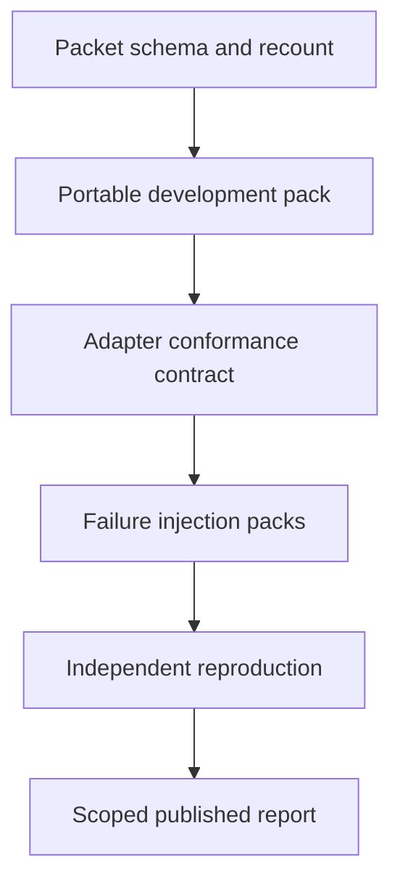

# Plan 5: a reproducible computer-use evidence lab

Proposed October 28, 2026 against local `main` at `5d494c6`. This is an alternative product direction. Only this plan was written; no experiment, test, provider request or application operation was performed.

Footwork would become a reusable laboratory for people building computer-use agents and drivers. Its primary product would be an experiment packet that another researcher can inspect, recount and, within declared host prerequisites, reproduce. The core question becomes: “Which capabilities does this exact agent/driver configuration establish, under which conditions, and where does it fail?” Demand for such a lab is a hypothesis, not a demonstrated market.

This direction makes independent measurement the deliverable. It differs from improving a common executor, polishing one end-user workflow, embedding verification in a running host, or presenting a human operator console. Runtime changes would serve reproducible experiments and bounded adapter contracts. The opportunity cost is slower consumer feature development and first-use polish for ordinary automation.

The repository already has substantial foundations. The [runner](../../../evals/runner.py#L40) defines stock, guarded, dual, delegation and ablation arms; [task rules](../../../evals/tasks/README.md#L13) distinguish observed-state predicates from judge-graded tasks and live-site drift. [Paired analysis](../../../evals/paired.py#L40) averages repeats within each task. Its legacy missing-field defaults illustrate a compatibility problem the lab must expose rather than silently treating unavailable measurements as zero.

Historical reports show why experimental custody matters. [Q19](../../../results/q19-heldout.md#L72) retains Calculator start-state contamination and interrupted-run handling. [VQ1](../../../results/vq1-local-20261008/report.md#L5) has frozen schedules and grouped scoring, while expressly qualifying no visual family from its mock smoke. [Reusable-body recovery](../../../results/reusable-body-recovery-20261012/report.md#L35) limits its findings to selected SIGKILL boundaries in loopback simulation. The [CI workflow](../../../../.github/workflows/ci.yml#L44) covers deterministic and simulation checks; it is not evidence of real-host task success. The [latest notebook](../../notebook/2026-10-28-native-observation-repair.md) likewise separates native observation from an accomplished application effect.

The proposed caller experience is a small lab interface, shown as a design sketch:

```text
footwork-lab inspect experiment.json
footwork-lab run experiment.json --output NEW_ATTEMPT
footwork-lab recount NEW_ATTEMPT
footwork-lab pack NEW_ATTEMPT --policy SHARE_POLICY
```

`inspect` reports exact prerequisites, dataset role, expected effects, spending limits and available coverage. A runner creates a fresh attempt; interrupted attempts retain their original identity and incomplete slots. `recount` recomputes published metrics from retained records without rerunning actions. `pack` creates a reviewed, redacted reproducibility bundle with explicitly unavailable private evidence. These commands are proposed, not implemented.

The architecture has four owners. A protocol layer freezes source/dependency/model/prompt identities, corpus provenance, arms, schedule, budgets, exclusions and decision rules. An adapter layer declares capabilities and controls fixture setup, execution and owned cleanup. An independent observation/scoring layer applies qualified oracles. A packet layer binds artifacts and produces human-readable reports. Existing browser, native, visual and simulation runners remain adapters; they need not become one execution runtime.

An experiment manifest and append-only attempt ledger define canonical accounting. Every scheduled slot is completed, refused, failed, contaminated, interrupted or not run. Unknown cost and missing observations stay unknown. Protocol changes create a new experiment version. The scorer preserves task/source groups, exposes unmatched cases and reports coverage beside comparative metrics. Neither an agent's completion claim nor a passing transport check becomes the ground-truth label.



| Milestone | Ownership and implementation scope | Proposed acceptance |
|---|---|---|
| 1. Versioned packets and deterministic recount | Protocol/report owner: proposed `evals/lab/manifest.py`, `packet.py`, `recount.py`; adapt `evals/report.py` and `paired.py` through compatibility readers. | First reviewable change: package one explicitly chosen development result and reproduce its documented aggregate from retained records. Reject changed members; identify missing data. Preserve original files and report differences introduced by schema interpretation. |
| 2. Portable development task pack | Fixture owner: `evals/fixtures/`, `evals/tasks/schema.py`, proposed `docs/lab/`; packaging owner: existing build helpers. | Supply one local browser family with explicit start-state reset, observed oracle, owned teardown and no paid model prerequisite for the scripted control. A second checkout can inspect and execute the documented control after declared dependencies are provisioned. |
| 3. Public adapter conformance | Adapter owner: proposed `evals/lab/adapters/`; integrate the existing browser runner first, then one independently implemented adapter. | Both adapters consume the same frozen task contract and emit the same result schema. Unsupported observations remain declared gaps. Conformance checks protocol behavior; they do not confer broad agent accuracy. |
| 4. Failure and adjudication packs | Recovery owner: scenario fixtures and bounded injection hooks; adjudication owner: scoring and annotation modules. | Exercise stale observations, duplicated requests, interrupted reporting, changed destinations and contaminated starts. Independent labels distinguish wrong effects, unsupported claims and truthful uncertainty. Each injection names its exact supported boundary. |
| 5. Independent reproduction release | Release owner: packet verifier, documentation and CI artifact jobs; independent reproducer owns a fresh attempt. | From the frozen public packet, reproduce offline scoring and a declared live or simulated development trial without source coaching. Publish discrepancies and missing evidence with the report. A subsequent adoption study uses newly sealed cases under a preregistered rule. |

Schema and fixture documentation can proceed together after the first packet shape is agreed. Adapter comparisons depend on common task and oracle semantics. Failure injection must wait for stable attempt identity. Independent reproduction depends on a frozen artifact, not an editable checkout. Delivery forecasts remain unavailable until the first external reproduction reveals setup and portability costs.

The proposed acceptance scorecard requires complete slot accounting, exact deterministic recount, rejection of packet tampering, and a successful documentation-only reproduction of the named control. Comparative reports must include denominators, grouping, exclusions, uncertainty and provenance. Live browser, native app, simulation, mock transport and replay evidence retain distinct labels. Historical report reconstruction may be possible even where its original environment cannot be reproduced; report those as different outcomes.

Existing heldouts stay sealed and are never used to debug the lab. New failure-class fixtures belong to development; later adoption uses an independently prepared frozen set. Human adjudicators record disagreements before resolution, and independence is described accurately. Confidence bounds on a finite corpus cannot certify universal capability. Related variants and replays must not inflate the independent sample count.

Migration is additive: compatibility readers reference historical artifacts and create versioned derived packets without rewriting past results. Partial attempts remain partial. Resume never automatically repeats an uncertain GUI operation; the adapter must reconcile it or end that slot as unresolved. Private traces and credentials stay outside export; missing source evidence limits what a packet supports. Rollback can retire the new CLI while retaining packet readers and original evidence.

Stop or narrow this direction if another builder cannot implement the adapter without adopting Footwork's runtime, if common grading erases material surface differences, or if independent reproduction costs exceed the value of the comparison. An offline audit/recount utility is a smaller fallback. Later implementation and substantive experiments require committed predictions, preregistration and frozen measured code. Network provisioning, paid calls, live-resource trials and publication need their applicable authorization. This plan selects none of those actions now.
