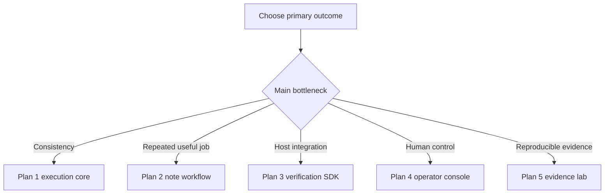

# Five different improvement plans for Footwork

**Latest synthesis:** the [single implementation plan](IMPLEMENTATION-PLAN.md) combines the strongest ideas after an [independent review of all five plans and Claude's work](review-20261028/README.md). It incorporates the user's requirement to diversify beyond TextEdit through Finder, Preview and a stateful browser application. The alternatives and original recommendation below are preserved as planning history; the new plan gives the concrete proposed implementation order.

Prepared October 28, 2026 from local `main` at `5d494c6a22921d092e67399badce708e8418bf2a`. Each plan was authored by a separate subagent assigned a different thesis, then reviewed together for scope and distinctness. This packet proposes alternatives; no direction is selected for implementation by its creation. Runtime files, thresholds, dependencies and historical results were not changed. No product tests, model evaluations or live application trials were run.

The October 9 [capability-system direction](../agent-superpowers-product-20261009.md) remains the recorded product decision. Plans 1 and 2 pursue different investments within or near that direction. Plans 3–5 propose larger changes in the primary audience and deliverable. The older [five architecture hypotheses](../five-architecture-hypotheses-v2-20261008.md) are useful historical design context; this packet does not present them as implemented or experimentally validated.

## Choose the outcome to optimize

| Plan | Primary user and deliverable | Who chooses the next action? | First useful result | Main opportunity cost |
| --- | --- | --- | --- | --- |
| [1. Shared execution core](01-execution-core.md) | Agent integrators get consistent operations through CLI, MCP and SDK | The calling host; Footwork owns admitted operations and evidence | Durable native append with transactional authority accounting and explicit recovery | User-facing feature breadth and onboarding receive less immediate attention |
| [2. Source-to-note product](02-workflow-product.md) | A user gets one useful, repeatable browser-to-document workflow | A versioned job advances through declared stages; the host supplies choices | An installed workflow produces an independently checked saved research note | Broad application and workflow coverage is postponed |
| [3. Verification SDK](03-verification-sdk.md) | Existing agent builders get a dependency-light evidence checker | The external host and its existing driver | Artifact equality and precisely scoped completion checks without adopting Footwork execution | Footwork relinquishes control over external actions, retries and publication |
| [4. Operator console](04-operator-console.md) | A person gets a visual local workspace for reviewing and directing operations | The person approves exact proposals and resolves uncertain cases | A target/evidence review and recovery experience usable without reading raw session files | Human attention remains part of the operating model |
| [5. Evidence lab](05-evidence-lab.md) | Researchers and adapter builders get reproducible computer-use evaluation | A frozen experiment protocol schedules bounded trials | A portable evidence packet that another investigator can validate and reproduce | Everyday task execution and consumer adoption receive less investment |

These plans have different owners of progress, different public interfaces and different definitions of success. They are competing primary roadmaps, although each must preserve the repository's existing authority and evidence requirements.

## The decisions that separate them

1. **Plan 1 asks whether the same operation can have the same guarantees everywhere.** Its test is execution parity and recovery. A successful implementation need not add a new end-user workflow.
2. **Plan 2 asks whether a particular completed job is useful enough to repeat.** Its test is independent first use, verified artifacts and intervention burden. It accepts a narrow implementation if that delivers the job reliably.
3. **Plan 3 asks whether evidence checking is useful without owning execution.** Its test is independent host integration and correct limits on claims. It cannot promise that an external driver acted safely or that a host will publish the checked answer.
4. **Plan 4 asks whether human review makes computer use understandable and controllable.** Its test is the person's ability to select the right target, understand a result and resolve uncertainty. It keeps the person in the progress loop.
5. **Plan 5 asks whether another investigator can reproduce a claim and discover a broken adapter.** Its test is evidence integrity, reproducibility and discriminatory conformance. A good benchmark packet alone does not establish a useful consumer product.

## Common source evidence, different responses

The current operator [dispatch path](../../../python/jevdual/session.py#L985) calls the bridge before persisting its pending record, while the [capability service](../../../python/jevdual/capability/service.py#L42) records durable operations before dispatch. [Completion extraction](../../../python/jevdual/completion.py#L32) still derives some field facts from prose. These are current source observations; this planning session did not reproduce the inferred failure windows.

Plan 1 makes those lifecycle differences the central migration. Plan 2 reuses the stronger bounded capability path and changes only what its note job requires. Plan 3 extracts checks while excluding mutation ownership. Plan 4 needs only a qualified operation seam sufficient for its attended interface. Plan 5 turns the differences into reproducible conformance cases and evidence requirements. A shared safety constraint does not make the five investments equivalent.

The [installed agent trial](../../../results/installed-agent-release-20261012-v2/report.md) establishes one scoped append and readback on an already-permitted host; it explicitly does not establish saved-file persistence or general first-use success. The [native repair notebook](../../notebook/2026-10-28-native-observation-repair.md) records improved capture binding and diagnostics. Neither record supplies missing product adoption evidence. Every plan identifies the new evidence it would need.

## Selection and execution order

My engineering recommendation is **Plan 1** if the goal is a dependable general capability platform: the source exposes a concrete operation-accounting inconsistency, and the existing capability implementation supplies a bounded starting point. The first decision should follow the native-append slice, before committing to migration of every route.

Choose **Plan 2** if the immediate question is whether someone can install Footwork and repeatedly obtain a useful result. Its principal uncertainty is workflow value and first-use burden, which a broad internal refactor would not resolve.

Choose **Plan 3** if integration reach and a small dependency footprint matter most; **Plan 4** if people must understand and control each operation; **Plan 5** if the intended contribution is reproducible research and adapter qualification. Those choices should explicitly revise the primary product direction.

Select one primary plan and complete its smallest reviewable milestone before reconsidering the investment. A later plan may reuse an artifact produced by the first, but implementing all five together would obscure which hypothesis earned its cost. Forecasts are unavailable until the chosen first slice establishes scope.

## Conditions for later work

Each detailed plan supplies its own milestone owners, dependencies, first change, acceptance criteria, disconfirming outcomes, migration and recovery. Numerical targets are proposals rather than results. Existing heldout data remains sealed according to its protocol. A substantive diagnostic test or experiment requires the repository's committed prediction/preregistration first. Implementation, external distribution, paid trials and live application work require the applicable task scope; the present request authorizes creation of the plans.
