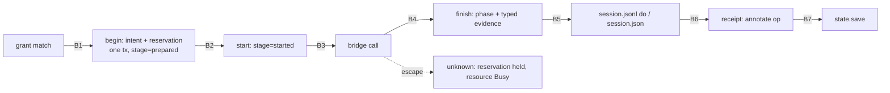

# A: Durable operator core

Synthesized October 28, 2026 against `main` at `5d494c6` from [Plan 1](../01-execution-core.md) and the five [critiques](../critiques/). This is a design document. No runtime, test, setting or result was changed to produce it. The reproducing test proposed below was deliberately **not** run, because its prediction has to be committed first.

**Thesis.** Every mutation an agent host makes through `footwork do` should get the guarantees the MCP capability already has:
- intent is committed before dispatch;
- a replayed token returns the operation already recorded;
- an unresolved attempt blocks its resource;
- evidence comes as typed records, not prose.

The work extends [`capability/journal.py`](../../../../python/jevdual/capability/journal.py#L1); it builds no new store. The primary user is a host that drives one session across separate shell invocations and must recover after a lost reply or a kill.

## Defects, checked in source

| # | Defect | Source |
|---|---|---|
| D1 | The grant is spent before dispatch. The narrow `except` lets a `CancelledError` or `KeyboardInterrupt` through, and in browser mode also a `TimeoutError` or `OSError`. When that happens no `do` record is written. A `TimeoutError` then reaches [`_legacy_main`](../../../../python/jevdual/cli.py#L453), which logs only a `stopped` record with no step number; a `CancelledError` passes that handler too. Nothing blocks the resource afterwards, so a click granted again can press a second time. | [session.py#L966](../../../../python/jevdual/session.py#L966), [#L1014](../../../../python/jevdual/session.py#L1014), [#L1034](../../../../python/jevdual/session.py#L1034) |
| D2 | **New finding.** A native driver exception raised *after* the press, including a timeout, becomes `effect="refused"` with `dispatched=True`. The session logs that as `driver_effect "refused"`, and completion counts `"refused"` as not sent. As a result, earlier `field_holds` stay usable and `repeat_of` skips the attempt. | [native.py#L1139](../../../../python/jevdual/native.py#L1139), [#L766](../../../../python/jevdual/native.py#L766), [completion.py#L37](../../../../python/jevdual/completion.py#L37); a test pins this behaviour at [test_completion.py#L191](../../../../tests/test_completion.py#L191) |
| D3 | `grants.json` is updated by an unlocked load, decrement and `write_text`, and `session.json` by a bare `write_text`. | [grants.py#L115](../../../../python/jevdual/grants.py#L115), [session.py#L85](../../../../python/jevdual/session.py#L85) |
| D4 | The field readback is stored as prose cut at 80 characters, so `field_holds` records a prefix of the value. | [session.py#L344](../../../../python/jevdual/session.py#L344) → [completion.py#L139](../../../../python/jevdual/completion.py#L139) |
| D5 | The save readback compares the file with the window, not with the expected content. | [native.py#L1330](../../../../python/jevdual/native.py#L1330) |
| D6 | No observation record is written, and the receipt drops delivery. `start` in a reused directory keeps the old `screenshots/` and `inspection/`. | [session.py#L432](../../../../python/jevdual/session.py#L432), [#L165](../../../../python/jevdual/session.py#L165), [#L470](../../../../python/jevdual/session.py#L470) |

The journal already provides most of what this needs: `BEGIN IMMEDIATE` ([#L424](../../../../python/jevdual/capability/journal.py#L424)), a process `flock` ([#L162](../../../../python/jevdual/capability/journal.py#L162)), token identity and `Busy` ([#L227](../../../../python/jevdual/capability/journal.py#L227)), and `dispatching→unknown` when the journal is reopened ([#L196](../../../../python/jevdual/capability/journal.py#L196)). Only its no-send recovery is append-specific, because it requires `recovery.packet_for`.

## Lifecycle and interrupt boundaries

| Boundary | Interrupted at | Required state (after reopening, for a simulated death) |
|---|---|---|
| B1 | before `begin` commits | no row; grant uses unchanged |
| B2 | prepared, not started | recovery records `not_sent`; reservation released |
| B3 | during the bridge call | `unknown`/`ambiguous`; reservation held; the next `do` is `busy`; `world.presses` unchanged |
| B4 | the bridge returned, `finish` has not run | `unknown` on reopen |
| B5 | `finish` committed, log not yet written | the next command projects the `do` record from the journal (`projected_from`); no second dispatch |
| B6 | before the receipt | the op is final without a readback; the next `look` annotates it |
| B7 | receipt logged, state not yet saved | readers dedupe on `op_id`; the first readback wins |

A death is simulated by raising a private `BaseException` subclass and then opening a new `Journal`, the pattern at [test_capability_recovery.py#L193](../../../../tests/test_capability_recovery.py#L193). A crash test establishes only the boundary it injects (critique 01).

**How dispatches are counted.** The `-25204` retry ([native.py#L1141](../../../../python/jevdual/native.py#L1141)) runs inside one `bridge.act` and is gated on `dispatches == 1`. Every CLI invocation builds a fresh bridge, so that gate is open on *every* `footwork do` click, not only on "a fresh runtime". The accounting is therefore:
- one `do` is one journal operation and at most `1 + retry` driver input calls;
- the evidence records `driver_calls` and `retry_reason`;
- "zero extra dispatches" means zero driver calls on a replay, and zero on a `Busy` resource.

M3 also narrows the retry so that it runs only when the fresh observation equals the one the decision was made on (reconciles critique 01 §3).

## Milestones

Each milestone is one PR. Its notebook entries go in `docs/notebook/<date>-durable-operator-core.md`, and the prediction is committed before the test that resolves it.

### M1: Reproduce D1 and D2 (first PR)

**Changes.**
- Add `test_escaped_dispatch_after_grant_leaves_a_blocking_attempt[CancelledError|TimeoutError|KeyboardInterrupt]` to [test_session_scenarios.py](../../../../tests/test_session_scenarios.py#L770). It uses the existing `boom` monkeypatch, wrapped so that it calls the real `NativeBridge.act` (the press lands) and then raises. The test then grants again and runs `do click Delete`.
- Add `test_driver_error_after_press_is_not_recorded_as_not_sent`, using a new `World.raise_after_press` knob in [native_world.py](../../../../tests/fixtures/native_world.py#L64).
- Both tests assert the behaviour after the fix. In the first, an `unknown` operation exists, the second `do` is `busy`, and `presses == ["Delete"]`. In the second, the attempt is not recorded as not sent, and an earlier readback on that surface is limited. Both are marked `xfail(strict=True)`; M2 removes the first marker and M3 the second.

**DOC1 prediction**
- Hypothesis: grant use and the `do` record are not atomic with dispatch, and nothing blocks an undetermined resource.
- Test: the first scenario, run before any fix.
- Predicts: `uses_left=0`, a `grant_used` record, no `do` record, and the second granted click dispatches (`presses == ["Delete","Delete"]`).
- Against: a `do` or `stopped` record that carries the step, or a second press that is refused.

**DOC2 prediction**
- Hypothesis: a post-press driver exception is logged as `"refused"`, and the earlier readback survives it.
- Test: the second scenario.
- Predicts: the receipt shows "not applied" and the prior `field_holds` stays usable.
- Against: the receipt is `unverifiable`, or the readback is limited.

**Acceptance.** Both tests fail for the predicted reason, recorded in an update. The rest of the suite is unchanged.

### M2: Journal-backed session `do` with grant reservations (fixes D1 and D3)

**Changes.** The reservation idea, token replay, and the migration rule come from critique 01 §5.

- **`journal.py`, additive only:**
  - `grants` and `reservations(op_id, grant_id, state: held|spent|released)` tables;
  - `begin(..., reserve=grant_id, stage="prepared")` decrements uses in the same transaction as the intent;
  - `finish` spends the reservation on `sent` or `ambiguous` and releases it only on a qualified `not_sent`;
  - an idempotent `annotate(op_id, "readback", …)`;
  - one generalization: `_recover` reads `stage='prepared' AND recovery IS NULL` as never started. The MCP path never writes that combination.
- **`grants.py`** keeps `Proposal`, `Grant`, `why_not` and `issue`. `load`, `save`, `consume` and `record` move behind the journal.
- **`session.py`:**
  - `cmd_do` opens `<session>/operations.sqlite` with task = `session_id`, resource = `mode:app:pid:window`, and observation = `last_snapshot`;
  - `except BaseException` records the op as `unknown` and re-raises;
  - `cmd_grant` writes to the journal;
  - `SessionState.save` writes to a temp file and calls `os.replace`.
- **`cli.py`:**
  - `do --token T` replays the recorded op and receipt, with no grant use and no dispatch. This mirrors [service.py#L52](../../../../python/jevdual/capability/service.py#L52);
  - `footwork resolve OP --applied|--not-applied --because TEXT` calls `Journal.resolve(by="operator")` and never refunds the grant;
  - `status` lists unresolved ops.
- A concurrent writer gets a typed `journal_in_use` refusal.

**Tests.**
- `test_capability_journal.py`:
  - `test_reservation_commits_and_rolls_back_with_intent`
  - `test_reservation_released_only_on_qualified_not_sent`
  - `test_reservation_held_while_unknown_across_reopen`
  - `test_capability_journal_from_5d494c6_opens_unchanged` (fixture DB)
  - `test_two_processes_never_lose_a_grant_use` (2×100 consumes)
- Scenarios:
  - `test_do_token_replay_returns_recorded_operation`
  - `test_do_token_reuse_with_other_words_conflicts`
  - `test_operator_resolve_unblocks_without_refund`
- `test_session.py::test_session_json_write_is_atomic`

**DOC3 prediction**
- Hypothesis: the journal's state machine covers session `do` with one generic change.
- Test: the M2 suite, plus a review of the `journal.py` diff.
- Predicts: DOC1's test passes, and `journal.py` gains no import outside `capability/` and no conditional keyed on a surface.
- Against: a second column or transition that only one surface uses becomes necessary. That triggers the stop rule.

**Acceptance.**
- 0 lost uses in 200 consumes.
- 0 driver calls on a replay or on a `Busy` resource.
- The 43 scenario tests and all `test_capability_*` tests stay green, with unchanged assertions.
- Guardrail: if the added time per fixture `do` has a median above 50 ms, stop and investigate.

### M3: Qualified no-send and the boundary matrix (fixes D2)

**Changes.**
- `NativeBridgeError` gains `sent: bool | None`. Each of the 16 raise sites is inventoried, and the ones before `self.dispatches += 1` ([#L1086](../../../../python/jevdual/native.py#L1086)) set `False`.
- `_effect` built from an exception is `phase=ambiguous`, except for driver codes on an explicit list of pre-delivery refusals (for example `stale_token`). That list is recorded like a setting.
- The `-25204` retry requires `effects.diff(decided, fresh)` to be empty.
- Browser mode keeps `dispatched=False` as its only qualified no-send. Its `RuntimeError` label is a known gap, deferred.
- `completion.py` gains a journal/1 reader that takes `phase` from the operation. The legacy `"refused"` rule still applies to old sessions. Critique 01 §4 first flagged the mislabelled `"not dispatched"`.

**Tests.**
- `tests/test_session_interrupts.py::test_boundary[B1…B7]`
- `test_25204_retry_is_one_operation_two_driver_calls`
- `test_25204_retry_skipped_when_fresh_observation_changed`
- `test_journal_session_ambiguous_refusal_limits_readback`

**DOC4 prediction**
- Hypothesis: classifying by raise site separates no-send from ambiguous without blocking ordinary refusals.
- Test: the boundary matrix, plus a count of `unknown` outcomes among the existing refusal scenarios.
- Predicts: all of B1–B7 hold, and at most 1 existing refusal scenario becomes `unknown`.
- Against: more than one does. Then the code list is revisited; `unknown` is never weakened.

### M4: Typed readback evidence (fixes D4)

**Changes.** The record design comes from critique 01 §5.2.

- `_field_receipt` emits `readback = {schema: "field_readback/1", producer, resource, attempt_id, label, value, value_sha, value_len, truncated}` next to the prose.
  - `value` is capped at 16,384 characters. Past that, `truncated=true` and the record supports no value.
  - A secret's readback carries neither `value` nor `value_sha`, because a short secret's digest can be brute-forced.
- `receipts.py` emits `navigation/1 {url_after}`.
- `completion.effects` and `repeat_of` read the typed records. The regex readers are frozen as `legacy_v0`.

**Tests.**
- `test_rewording_receipt_prose_leaves_effects_floor_and_repeat_guard_unchanged`
- `test_81_character_append_yields_the_full_value`
- `test_oversized_readback_supports_no_value`
- `test_secret_readback_has_no_digest`
- `tests/test_completion_legacy.py::test_legacy_reader_frozen_on_committed_sessions`. It runs `effects()` over all 216 committed `results/**/session.jsonl` files and compares the output with a snapshot taken in the PR's first commit, before `completion.py` changes. This covers the input of [m1_offline.py](../../../../scripts/m1_offline.py#L33) and [m6_offline.py](../../../../scripts/m6_offline.py#L28).

**DOC5 prediction**
- Hypothesis: verdicts depend only on the facts the producer records.
- Test: the rewording test and the legacy snapshot.
- Predicts: the rewording test passes, and the snapshot shows 0 differences.
- Against: any difference. That would amount to regrading old results, so the reader is fixed and no number is touched.

A read-only scan for this plan found 102 `now holds` readbacks among the 653 committed receipts, none of them 80 characters or longer. Freezing the legacy reader therefore moves no recorded number.

### M5: Save as its own operation; a complete session log (fixes D5 and D6)

**Changes.**
- A save (Command-S, or a menu path ending in Save) is journaled with `move="save"`. An `unknown` append on the same resource blocks it through `Busy` (critique 02 §6.1).
- `save_readback` reads the file through the no-follow reader at [artifacts.py#L42](../../../../python/jevdual/artifacts.py#L42) and returns `save_readback/2 {path, dev, ino, disk_sha256, window_sha256, expected_sha256|null}`.
  - The expected content is the latest usable `field_readback/1` for that text area.
  - `saved` is usable only when the disk digest equals the expected digest.
  - With no expected content, `saved` is limited.
- `observe` logs `{kind: "observation", generation, snapshot, screenshot, screenshot_sha256, withheld}`.
- The `do` record carries `delivery: {declared, driver_reported, dispatched}` from `NativeEffect` ([native.py#L507](../../../../python/jevdual/native.py#L507)). The receipt's page-probe word stays `"unknown"` when nothing was probed, but it is now written rather than dropped.
- `start` removes the `screenshots/`, `inspection/` and `operations.sqlite*` it owns, and refuses if any of them is a symlink.

These log changes come from critique 04 §1.

**Tests.**
- `test_session.py` (extending [#L192](../../../../tests/test_session.py#L192)):
  - `test_save_readback_of_unexpected_content_is_not_saved_evidence`
  - `test_save_without_expected_content_is_limited`
- Scenarios:
  - `test_save_blocked_by_unknown_append`
  - `test_start_in_reused_dir_leaves_no_prior_capture`
  - `test_every_observation_logged_with_matching_digest`
  - `test_do_record_carries_bridge_delivery`

**DOC6 prediction**
- Hypothesis: today a task that names a save can pass `floor` on a save of the wrong content.
- Test: the first `test_session.py` test, run before the change.
- Predicts: the floor passes before the change and refuses after it.
- Against: the floor already refuses it.

**Acceptance.**
- 100% of new observations have a record whose digest matches the PNG.
- 0 files from a prior session remain after `start`.

## Persisted formats and migration

| Artifact | New sessions | Old sessions |
|---|---|---|
| `operations.sqlite` | One per session. `grants`, `reservations` and `meta(schema="journal/1")` are added with `IF NOT EXISTS`. | absent |
| `session.json` | adds `session_id` and `store: "journal/1"` | no `store`, so the session is **read-only**: mutating commands refuse with `legacy_session_read_only` |
| `session.jsonl` | Becomes a projection of the journal. `do` adds `op_id`, `phase` and `delivery`; receipts add `readback`; there is a new `observation` kind. | read by `legacy_v0` |
| `grants.json` | no longer written | shown by `status`, never consumed |

Two rules apply to old sessions:
- A legacy `do` without a following receipt, or a non-null `pending`, is reported as `unknown`. Nothing is converted and no evidence is invented (critique 01 §5.4).
- MCP journals keep working because the schema change is purely additive. On rollback, `start` goes back to the legacy path; journal/1 sessions stay readable but the old executor never replays them.

## Stop and redirect

- **Surface branching.** Suppose M2 or M3 needs any of these in `journal.py`: a column used by only one surface, a transition used by only one surface, or an import from `session`, `native` or `browser_driver`. Then keep the shared records and the journal primitives, and write `SessionOperations` as a per-adapter service beside `CapabilityService` (critique 01 §5.5).
- **DOC1 does not reproduce.** Revise the diagnosis before building M2.
- **An existing capability journal will not open.** Revert the schema change and stop. Intent and reservation must share one transaction, so the database is not split.
- **Too many unknowns.** If the DOC4 count is over its bound, fix the classification. `unknown` is never softened.
- **Legacy reader drift.** Any difference in the legacy-equality test blocks M4.

## Touch points with B and C

- **B (auditable workflow).** The `footwork report` timeline needs M2's operation IDs, plus M5's observation records, delivery and save operation. Without them it has to print "not recorded". A builds no report itself; it supplies journal/1 fixture sessions.
- **C (evidence contract).** `field_readback/1`, `navigation/1` and `save_readback/2` are producer records that C's typed result envelope (critique 03 §6.1) should embed. If C's envelope lands first, M4 emits it. C owns the packaging, the mutant-adapter suite and slot accounting. A's B3 test is the template for C's mutant that "retries an uncertain operation" (critique 05 §6.2).

## Out of scope

- a new `execution/` package;
- seven record types (only the operation row, Reservation and Evidence are needed);
- an SDK with `observe`, `perform` and `reconcile`;
- migrating the browser route, `agent.py`, `desktop.py` or the browser-use hooks (browser `do` gets only M2's generic guarantees);
- giving the CLI and MCP equal authority (grants and resource scope differ by design);
- release work;
- live application runs and model evaluations.

## Corrections to the critiques

1. **Critique 01, the timeout.** It says a `TimeoutError` escapes. On the native bridge it does not: it becomes a "refused" receipt, which is D2. On the paths where it does escape, [cli.py#L463](../../../../python/jevdual/cli.py#L463) still writes a `stopped` record, though without a step number.
2. **Critique 01, the journal.** It calls the journal generic. That is true except for no-send recovery, which needs an append packet.
3. **Critique 01, the `-25204` retry.** It is not limited to the first press of a runtime; the retry is eligible on every CLI click.
4. **Critique 02, the save readback.** It says a save of the wrong content is "confirmed". That is true, but `saved` carries no values, so the real exposure is `floor` for tasks that name a save.
