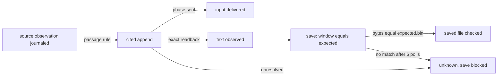

# Plan B: an auditable workflow (value first)

Written October 28, 2026 against `5d494c6`. This is a plan only: no runtime change, model evaluation or live application run went into it. The one read-only check run was `pytest tests/test_artifacts.py tests/test_session_scenarios.py -k "artifact or capability"` (51 passed).

**Thesis.** An installed host agent can complete one job that needs GUI control, and afterwards a developer can audit what it did, without a general core rewrite. The host agent owns the plan, and each intervention counts as a cost ([direction L15](../../agent-superpowers-product-20261009.md#L15), [L85](../../agent-superpowers-product-20261009.md#L85)). The developer reads a static report afterwards. From Plan A, B takes only two pieces: a **journaled save operation** and **observation records in the journal**. From Plan C, B uses only the existing [`check_artifact`](../../../../python/jevdual/artifacts.py#L42).

## 1. The job, and why it needs a GUI

> "Copy the balance due shown in my signed-in billing portal into the expenses log I keep open in TextEdit, and save it."

The job needs a GUI because of where the value lives. It exists only in an authenticated session in Footwork's own Chrome profile ([browser_driver.py#L10](../../../../python/jevdual/browser_driver.py#L10)), and the page renders it with a script after login. The host has no credential and no API, so its own fetch gets a 401. This fixes the demand flaw that critique 02 identified ([§2](../critiques/02-workflow-product-critique.md)): the current fixture puts its value in public HTML ([capability_fixture.py#L24](../../../../scripts/capability_fixture.py#L24)), so `curl` can solve it.

**Fit with current contracts.**
- **Source.** Source scope is loopback-only ([backend.py#L57](../../../../python/jevdual/capability/backend.py#L57)), so the first version is an *authenticated loopback fixture*.
- **Destination.** The destination must already be open, and its window must name the scoped document ([backend.py#L108](../../../../python/jevdual/capability/backend.py#L108)).
- **No creation.** Nothing is created ([contracts.py#L75](../../../../python/jevdual/capability/contracts.py#L75)).
- **Append only.** Append is the only move ([backend.py#L172](../../../../python/jevdual/capability/backend.py#L172)).

An existing document is therefore the code's natural case. Plan 02's new-file destination would have needed a file-creation feature.

**Repeat use** resolves critique 02's contradiction between "new destination only" and repeat use:
- Each job is a new task with its own scope and manifest, against the *same* existing document.
- The manifest records `initial_sha256` and the previous job's `final_sha256`.
- If they differ, the report shows "file changed between jobs" and the job proceeds, because people edit their own logs.
- At bind, the window text encoded as UTF-8 must equal the file bytes. Otherwise the job refuses `destination_unsaved`, since a save would persist someone else's edits.
- A file that is not UTF-8, or that contains `\r`, refuses `unsupported_encoding`.

**Limit.** A same-user host that reads Chrome's cookie store can bypass all of this. The fixture shows what is necessary within the host's granted tools; it does not contain the host.

## 2. Job manifest

`job.json` (mode 0600) is derived deterministically from journal rows; it is never a second source of truth.

| Field | Source |
|---|---|
| `source_observation` | ID, URL, title, `text_sha256` and coverage of the journaled source observation |
| `passage`, `passage_sha256`, `rule` | Validated by `act` at append time |
| `destination` | Resolved path, boot, TextEdit pid and start time. Not the inode, which safe-save replaces ([recovery.py#L161](../../../../python/jevdual/capability/recovery.py#L161)) |
| `append_op`, `save_op` | Journal IDs, state, disposition, phase |
| `initial_sha256`, `expected.bin`, `expected_sha256` | Initial bytes + separator rule + appended text |
| `final_check` | `check_artifact(document, expected.bin, expected_sha256)` and its time |

**Rule `fw-projection-v1`** mirrors the projection exactly:
- content lines are whitespace-collapsed ([L199](../../../../python/jevdual/browser_driver.py#L199));
- consecutive repeats are dropped ([L200](../../../../python/jevdual/browser_driver.py#L200));
- candidate values, clipped at 200 characters ([L188](../../../../python/jevdual/browser_driver.py#L188)), are appended after the content lines ([L202](../../../../python/jevdual/browser_driver.py#L202));
- the text is capped at 6000 characters ([L215](../../../../python/jevdual/browser_driver.py#L215)).

A valid passage must:
- be one or more consecutive whole lines of `text`;
- fall within the cap, in an observation with `text_truncated=false` and `elements_complete=true`;
- contain no line that equals a candidate value, since such a line may have been clipped.

The digest is `sha256(passage.encode("utf-8"))`, with no Unicode normalization because the projection applies none. The appended text must contain the passage verbatim. For the second read route that critique 02 asks for, the fixture server applies the same rule to the text it rendered and writes that ground truth privately.

## 3. Save

**Save is its own journaled operation**, a sixth MCP tool `save {target, client_token}`. It comes from critique 02 §6.1 and is the narrow slice of Plan A. It is offered only if the scope sets `destination.save = "foreground_permitted"`.

That setting is necessary. The capability bridge is built without a policy ([backend.py#L96](../../../../python/jevdual/capability/backend.py#L96)), so it defaults to `background_only` ([native.py#L648](../../../../python/jevdual/native.py#L648)), and today a menu save would be refused `requires_foreground`. Under the new setting, input from the person in the last 3 s ([posture.py#L47](../../../../python/jevdual/posture.py#L47)) yields `human_active`, a no-send refusal.

Save runs in this order:
1. **Prerequisite.** The task's cited append must be `final/applied`. An unresolved append already blocks the resource ([service.py#L64](../../../../python/jevdual/capability/service.py#L64)).
2. **Fresh checks.** The document identity must be unchanged, and the window must equal `expected.bin`. Equality with the file alone is not enough.
3. **Autosave check.** If the disk already equals `expected.bin` (TextEdit autosave), the save is `not_sent` with reason `already_on_disk`.
4. **Intent.** `journal.begin` records the intent.
5. **Dispatch.** `NativeBridge.menu(["File","Save"])` runs in-process. There is no durable worker packet, so a crash becomes `unknown` through [`_recover`](../../../../python/jevdual/capability/journal.py#L196).
6. **Readback.** The disk bytes are compared with `expected.bin`.

**Readback fix.** `save_readback` decodes the file with `read_text()` ([native.py#L1330](../../../../python/jevdual/native.py#L1330)) and compares it with the *window* ([L1334](../../../../python/jevdual/native.py#L1334)). It therefore certifies whatever the window holds, and universal-newline decoding makes a CRLF file equal LF text. The fix:
- adds `expected: bytes | None`;
- reads through [`read_regular`](../../../../python/jevdual/artifacts.py#L19) (no symlinks, change-detected);
- adds `basis: "window" | "expected_bytes"`;
- records `polls` and `elapsed_ms`.

**First-save timing.** The 6 × 0.5 s poll in [`_after_save`](../../../../python/jevdual/native.py#L1231) exists because 4 of 6 first Command-S readbacks read "differs" at 0.5 s ([L1234](../../../../python/jevdual/native.py#L1234)). Bytes that never land leave the save `unknown`. Trials record the poll index of each match. Changing the budget is a settings change.

**An uncertain append blocks save, and a new token is not recovery.** A task allows exactly one non-refused cited append (`job_append_exists`). After a lost reply the host can only call `status`.

## 4. `footwork report DIR`

The report is one static HTML file. It reuses the [inspection-preview CSP](../../../../python/jevdual/session.py#L738) (`script-src 'none'`) and escapes all text. It opens SQLite `mode=ro` and never takes the journal lock. There is no server and no in-console approval (critique 04 §7). Each label is shown as a word, a glyph and its field path, never as color alone, and a missing field reads "not recorded".

| Label | Capability job | Operator session |
|---|---|---|
| input delivered | `append_op.phase == "sent"` | new `do.dispatched` (true/false/null) |
| text observed | `evidence.readback.kind == exact_field_readback` and `passed` | `receipt.effect` with `basis` |
| saved file checked | `final_check.ok`, re-run at report time | a `check_artifact` record only |
| unknown | an unresolved state or `unknown` disposition | `pending` with no receipt |

**Minimal logging additions.** Critique 04 §1 holds: there are no observation records, and delivery is dropped at [session.py#L165](../../../../python/jevdual/session.py#L165). Three additions close the gap:
1. A journal `observations` table. Observations are memory-only today ([observations.py#L39](../../../../python/jevdual/capability/observations.py#L39)).
2. An operator `observation` record holding the generation, `text_sha256`, and either the screenshot path with its sha256 or "withheld". Today screenshots are written unlogged ([session.py#L428](../../../../python/jevdual/session.py#L428)).
3. A `do.dispatched` field, set to `null` when dispatch raised. Critique 01 found that `"not dispatched"` is a mislabel ([session.py#L1014](../../../../python/jevdual/session.py#L1014)); with this field it no longer counts as evidence, and the `driver_effect` wording that `completion.py` parses stays unchanged.

Screenshots come only from these records, because `start` keeps old `screenshots/` ([session.py#L470](../../../../python/jevdual/session.py#L470)).

## 5. Milestones

There are five milestones, one mergeable PR each. Predictions go in `docs/notebook/2026-10-29-auditable-workflow.md`, committed before the test that resolves them.

**M1. Save readback against expected bytes (first PR).**
- **Prediction AW1:**
  - Hypothesis: `save_readback` returns `ok=True` (a) after saving a concurrent window edit and (b) for a CRLF disk against an LF window.
  - Predicts: both new tests fail on `5d494c6` with `ok=True`.
  - Against: either already returns `False`.
- **Changes:** `native.save_readback`, `with_save_readback`, `_after_save`. [`TextWorld`](../../../../tests/fixtures/native_world.py#L176) gains `save_mode ∈ {write, refuse, write_other, none}`, `save_delay_polls`, and fakes for `press_menu`, `document_path` and `text_area_values`.
- **Tests:** `test_save_readback_refuses_bytes_other_than_expected`, `test_save_readback_reads_bytes_not_universal_newlines`, `test_save_readback_records_polls_for_delayed_write`, `test_save_readback_symlinked_document_unverifiable`.
- **Accept:** the first two fail before the fix, and an update records the cause. All four pass after the fix. Existing scenarios are unchanged apart from the new `basis` field.

**M2. Observation records and cited append.**
- **Changes:**
  - `journal.py`: an `observations` table, `record_observation`, and `observation`.
  - `ToolFacade`: bind and observe record each projection.
  - `contracts.py`: `act` gains optional `source_observation` and `passage`.
  - A new `capability/citation.py` provides `passage_ok`.
  - `backend.validate` re-observes the source and requires the passage there; otherwise it returns `source_changed`.
  - `recovery.packet_for` and `validate_packet` ([L236](../../../../python/jevdual/capability/recovery.py#L236), [L282](../../../../python/jevdual/capability/recovery.py#L282)) accept the cited args. The worker still writes only `text`.
  - `service.act` enforces `job_append_exists`.
- **Prediction:** this is conformance work, which per the notebook README needs no prediction. It does register **AW2**, resolved in M5: the real projection of the authenticated page emits the balance line byte-equal to the server's ground truth. Against: any mismatch.
- **Tests:** `test_cited_append_records_observation_and_passage_digest`, `test_passage_not_whole_lines_refused_nothing_sent`, `test_passage_from_truncated_or_value_line_refused`, `test_legacy_append_packet_still_validates`, `test_second_cited_append_in_task_refused`.

**M3. Journaled save and manifest (the narrow A slice).**
- **Changes:**
  - `TOOL_SCHEMAS["save"]` and `ToolFacade`.
  - `_check_scope` accepts an optional `destination.save`; old scopes and their recovery digests are unchanged.
  - Backend save follows the steps in section 3.
  - A new `capability/job.py` provides `write_manifest` and writes `expected.bin`.
  - `_receipt` reports save persistence instead of the constant at [service.py#L341](../../../../python/jevdual/capability/service.py#L341).
- **Prediction AW3:**
  - Hypothesis: the existing resource block plus `job_append_exists` stop every save after an uncertain append, with no new locking.
  - Predicts: zero `press_menu` calls in the changed-source, wrong-document, conflicting-edit and unknown-append scenarios.
  - Against: any press, or `final_check.ok` while the bytes differ.
- **Tests:** section 7.

**M4. Report, then comprehension test.**
- **Changes:** a new `python/jevdual/audit_report.py`, the `cli.py` `report` subcommand, and the logging additions from section 4.
- **Tests:** `test_report_is_script_free_and_escapes_page_text`, `test_report_labels_never_exceed_evidence` (over every M3 scenario and four operator sessions), `test_report_old_session_reads_not_recorded`, `test_report_ignores_unlogged_screenshots`.
- **Preregistration** `docs/experiments/B1-audit-report-comprehension.md`, committed before any case is shown:
  - **Cases:** 12 (8 job scenarios and 4 operator sessions), each with 4 labels.
  - **Auditors:** six fresh-context agent auditors as stand-ins, plus at least one human developer as a guardrail sample.
  - **Design:** crossover, so each auditor sees half the cases as the report and half as raw `session.jsonl` and journal rows.
  - **Primary metric:** the share of labels classified correctly.
  - **Critical error:** answering "saved and checked" when `final_check` is not ok.
  - **Decision:** adopt the report if it scores at least 10 points above raw with zero critical errors. Otherwise redesign the page; label semantics never change to fit. No server follows under either outcome.

**M5. Authenticated fixture and first-use trials.**
- **Changes:** `scripts/capability_fixture.py --authenticated` and a new frozen `scripts/auditable_job_trial.py`. The fixture provides:
  - a login with a fixture demo credential, per [CONTRIBUTING](../../../../../CONTRIBUTING.md);
  - an HttpOnly cookie;
  - a per-session amount fetched by script;
  - a seeded `expenses.txt` with three prior lines, opened clean;
  - private ground truth.
- **Preregistration** `docs/experiments/B2-auditable-job-first-use.md`, committed before freezing the packet:
  - **Trial 1 (already permitted):** six attempts, each in a fresh host process with the same prompt and bundle. Three are single jobs. Three form a chain on one document, with TextEdit quit and reopened before the third.
  - **Trial 2 (observed denied→granted):** three attempts on a disposable guest that start with Accessibility denied, in the [U3](../../../experiments/U3-packet-v4-permission-journey.md) style. The human grant is the one expected human step.
  - **Primary metric: verified-job rate.** An attempt counts when `final_check.ok` holds, the passage equals the ground truth, and the host's final claim does not exceed the report labels. Denominators are fixed in advance, every attempt counts (including preparation failures), and none is re-graded.
  - **Guardrails:** zero wrongly certified effects, zero duplicate appends, zero lost prior bytes, and no intervention beyond the grants. Elapsed time and spend are recorded.
  - **Baseline (copy-assist):** the same host, model, prompt and job instances, with no Footwork. The host may ask a scripted stand-in once, gets the displayed value verbatim, and writes with its own tools. The same oracle scores it. The baseline gets a perfect value and pays no time penalty, so it is not rigged against copy-paste. Footwork can win only on interventions per verified job and on audit evidence. Elapsed time is reported but does not decide anything, since copy-paste wins it by construction.
  - **Decision:**
    - **Proceed:** Trial 1 at least 5/6 and Trial 2 at least 2/3, with the guardrails held, leads to proposing a real-origin scope as a new package.
    - **Redirect:** Trial 1 at 3/6 or below redirects to Plan A.
    - **Inconclusive:** anything else means new development scenarios and a new frozen packet, never a re-grade.
    - **Revisit the premise** if the baseline matches Footwork on both verified rate and interventions (critique 02 §6.6).

## 6. Acceptance criteria (each can fail)

- Every section 7 test fails before its fix and passes after.
- Report labels never exceed the evidence, in 100% of cases.
- The comprehension test shows at least +10 points with zero critical errors.
- Trial 1 reaches at least 5/6, and Trial 2 at least 2/3.
- Zero wrongly certified effects anywhere.
- No existing test changes beyond the new `basis` and `dispatched` fields.

## 7. Failure scenarios → `tests/test_session_scenarios.py`

All scenarios use a `job_capability` fixture modelled on [`text_capability`](../../../../tests/test_session_scenarios.py#L27). Its source is a fake bridge built with the real `menu_from_semantic`, and its destination is a `TextWorld` that can save. Each test also asserts the report's labels.

| Scenario | Test | Expected |
|---|---|---|
| Changed source | `test_job_changed_source_refuses_cited_append` | `source_changed`, nothing sent |
| Wrong document | `test_job_wrong_document_refuses_save_no_press` | `lost_identity`, zero presses |
| Duplicate request | `test_job_duplicate_token_replays_and_new_token_refused` | `repeat=True`; `job_append_exists` |
| Conflicting edit | `test_job_edit_between_append_and_save_refuses_save` | `precondition_changed`, not saved |
| Save refusal | `test_job_save_human_active_is_not_sent` | `not_sent`; "saved file checked: no" |
| Lost reply | `test_job_lost_append_reply_recovers_by_status` | same operation ID, no second append |
| Additional | `test_job_save_blocked_after_unknown_append`, `test_job_autosave_already_on_disk`, `test_job_save_bytes_never_land_stays_unknown` | as in section 3 |

## 8. Risks, stop rules, scope

**Risks:**
- Autosave makes authorship of the saved bytes unprovable, so the label claims file state, not authorship.
- Save takes the foreground.
- 3 s may be too short on real hardware.
- Page text reaches the host's context and can carry injected instructions.
- Agent auditors may overstate how well developers comprehend the report.
- n = 6 and n = 3 do not establish reliability.

**Stop or redirect:**
- Any wrongly certified effect halts expansion and becomes a new scenario.
- If more than 1 of 6 trial saves end `unknown`, ship the job append-only, with persistence "not checked".
- A false accept by the passage rule restricts passages to one line.
- If the report does not beat raw records, it does not ship.

**Ownership:**
- **From A, B takes** only the journaled save and the observation table.
- **To A, B leaves** grant reservations, routing session `do` through the journal, typed readback for every operator operation, and interruption harnesses.
- **To C, B leaves** the evidence schema, packaging and mutant adapters.

**Out of scope:**
- Non-loopback origins and personal Chrome profiles.
- RTF, file creation, and apps other than TextEdit.
- A GUI close/reopen check.
- Any server, console or in-console approval.
- A public recipe layer ([direction L15](../../agent-superpowers-product-20261009.md#L15)).
- Summarization.

**Corrections to the critiques:**
- Critique 02's persistence disclaimer is at `contracts.py:68`, not 69.
- Critique 02 misses the universal-newline comparison.
- No plan or critique notices that the `background_only` default blocks any save.
- Critique 04's "input delivered always unknown" is too strong: `do.driver_effect` already marks posture refusals "not sent". It is its "not dispatched" value that cannot be trusted.
