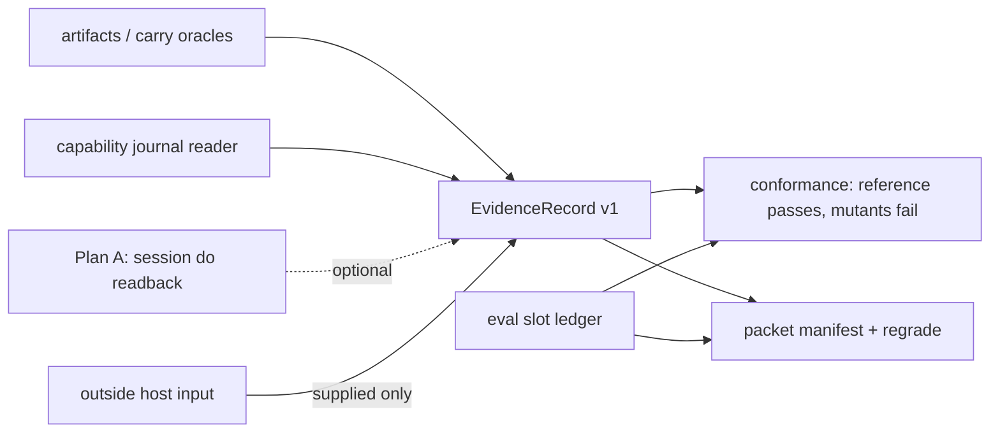

# Plan C: evidence contract and conformance

Synthesized October 28, 2026 against `main` at `5d494c6`. It draws on plans [03](../03-verification-sdk.md) and [05](../05-evidence-lab.md) and their critiques ([03c](../critiques/03-verification-sdk-critique.md), [05c](../critiques/05-evidence-lab-critique.md)). Critique findings were rechecked in source before use. The only commands run were read-only unit tests (225 passed across the artifact, completion, capability-completion, paired, carry, adjudication and VQ1-scoring modules) and two probes kept in the scratchpad. Paths are relative to `jevdual/`.

**Thesis.** Define one versioned, typed evidence record and a conformance suite that can tell a correct adapter from a broken one. The same rules then judge Footwork's own adapters, outside hosts and experiments, and a broken adapter visibly fails. Primary users are adapter and host integrators, and investigators. No outside adapter author is assumed. Demand is tested before milestone 6 (M6).

## What the source already gives, and what it gets wrong

| Finding | Evidence |
|---|---|
| The record's kinds already exist. `Effect` carries `effect, resource, kind, step, t, detail, values, limits`, and `KINDS = (current_state, event, answer)`. | [completion.py#L31](../../../../python/jevdual/completion.py#L31), [#L83-L99](../../../../python/jevdual/completion.py#L83) |
| The artifact result has no `dev`/`ino`, observation interval or check version. | [artifacts.py#L42-L48](../../../../python/jevdual/artifacts.py#L42) |
| `O_NOFOLLOW` guards only the last path component. A probe read `…/link/f` through a symlinked parent. | [artifacts.py#L22](../../../../python/jevdual/artifacts.py#L22) |
| **New finding:** the carry oracles use `path.exists()` and `read_text()`. They follow symlinks and have no size bound. | [carry.py#L192-L202](../../../../python/jevdual/carry.py#L192), [#L251](../../../../python/jevdual/carry.py#L251) |
| Answer support checks only that atoms are present. A probe showed `check_claims("Revenue fell 5%.", "Revenue rose 5% …")` grades `exact`. `supported` is also `True` for `narrative`. | [verify.py#L91](../../../../python/jevdual/verify.py#L91), [#L167-L195](../../../../python/jevdual/verify.py#L167) |
| History requires Footwork's journal: the `operations` table plus a read-only identity-checked open. | [journal.py#L37](../../../../python/jevdual/capability/journal.py#L37), [capability/completion.py#L86](../../../../python/jevdual/capability/completion.py#L86), [#L205](../../../../python/jevdual/capability/completion.py#L205) |
| The `footwork-capability report` JSON CLI already exists. | [capability/cli.py#L84-L99](../../../../python/jevdual/capability/cli.py#L84) |
| The install gate is vacuous: the builder copies every `Requires-Dist`, and the check installs with `--no-deps`. | [build_capability_wheel.py#L69](../../../../scripts/build_capability_wheel.py#L69), [capability_package_check.py#L85](../../../../scripts/capability_package_check.py#L85) |
| Missing values become 0 in paired comparisons. **Also:** `TaskResult` cost fields are non-optional floats, so the producer cannot even say "unknown", and `cost per verified pass` prints 0 when there are no verified passes. | [paired.py#L47](../../../../evals/paired.py#L47), [#L56](../../../../evals/paired.py#L56), [report.py#L22](../../../../evals/report.py#L22), [#L160](../../../../evals/report.py#L160) |
| `run_split` has no schedule. Resume skips completed `(task, arm)` pairs and silently re-runs one that was in flight. | [runner.py#L698-L747](../../../../evals/runner.py#L698) |
| Redaction rewrites only `.json`, `.jsonl`, `.md` and `run.log`. | [redact_results.py#L57-L62](../../../../scripts/redact_results.py#L57) |
| Reusable parts: the packet verifier (which assumes a single wheel), VQ1 `freeze`/`score_run`, adjudication eligibility, the `Backend` protocol, and the SIM9 12-case matrix. | [verify_onboarding_packet.py#L12-L58](../../../../scripts/verify_onboarding_packet.py#L12), [vq runner.py#L180](../../../../evals/visual_qualification/runner.py#L180), [#L339](../../../../evals/visual_qualification/runner.py#L339), [adjudication.py#L20](../../../../evals/adjudication.py#L20), [contracts.py#L53](../../../../python/jevdual/capability/contracts.py#L53), [SIM9](../../../experiments/SIM9-network-body-adapter.md) |

## The record (schema v1)

```text
EvidenceRecord{schema: 1, predicate, check_version, kind: current_state|event|answer,
  source_adapter, provenance: direct|supplied, resource: {path, dev, ino} | {id},
  observed_at: [start, end], digests: {name: sha256}, outcome: supported|refuted|unknown|unavailable,
  limits: [str]}
```

Rules, each enforced by a test:

1. **Kinds never convert.** No function takes a record of one kind and returns another kind. A historical "applied" never implies current state.
2. **Only a configured adapter that reads the evidence itself may set `provenance: direct`.** Anything a host hands in is `supplied`. A supplied event record can never be `supported`.
3. **`unknown` is sticky.** Interruption, re-reading or a later matching text cannot raise it.
4. **`check_version` is `<predicate>/<n>`.** Any semantic change mints a new `n`. Stored records keep their outcome, and nothing regrades them.
5. **Unknown is `null`, never 0.** This applies to cost, observations and fields alike.

**Honest scope for outside hosts** (03c §2). An outside host can get:

- direct current-state checks on files;
- `supplied` history records, or `unavailable` when no Footwork journal exists;
- `atoms_present` answer records.

Answer records are renamed from "support" because the check tests atom presence, not entailment or polarity. Each carries the standing limit `atom presence only; polarity and entailment unchecked`, and a narrative sentence yields `unknown`. `verify.py` behaviour is unchanged, so no past grade moves. An entailment check (Jev) would be a separate, heavyweight `check_version` outside the light package. It is not planned here.



## Milestones

Each milestone is one mergeable PR. The notebook file is `docs/notebook/<start-date>-evidence-contract.md`. Each prediction below is committed **before** the commit holding the test that resolves it. All fixtures are new development fixtures; `heldout.yaml` and `live-heldout.yaml` are never read.

### M1 — Slot ledger; unknown is null (first PR, evals only)

- **New module `evals/slots.py`.** `run_split` ([runner.py#L698](../../../../evals/runner.py#L698)) writes `slots.json` before the first task runs. Every `(task, arm, repeat)` slot is entered as `not_run`, then finalized to exactly one of `completed`, `refused`, `failed`, `contaminated`, `interrupted` or `not_run`.
- **Interruption.** A `finally` that catches `BaseException` marks the in-flight slot `interrupted`. On resume, an interrupted slot stays interrupted and any rerun opens a new attempt ID. `contaminated` is set only through adjudication `ELIGIBILITY`.
- **Unknown stays null.** `TaskResult.llm_cost_usd` and `jev_cost_usd` become `float | None`. `paired._rows` reports a per-field known denominator. `report.py#L160` prints `n/a`, not 0.
- **Tests:** `test_every_scheduled_slot_ends_in_exactly_one_state`, `test_interrupt_marks_in_flight_slot_interrupted`, `test_resume_keeps_interrupted_slot_and_opens_new_attempt`, `test_contaminated_only_from_adjudication`, `test_missing_field_is_unknown_not_zero`, `test_paired_reports_known_denominator`.
- **EC1 (prediction):**
  - *Hypothesis:* the zero default has already moved committed paired numbers.
  - *Test:* recompute `paired` over every committed `results/*/results.json`, once with the old reader and once with the new one, in a scratch directory.
  - *Predicts:* at least one directory has rows missing `llm_requests` or `done_rejections`, and its paired mean differs between the two readers. The update lists those directories.
  - *Against:* no committed directory lacks those fields, which would make the fix forward-only.
- **Acceptance:**
  - An injected `KeyboardInterrupt` at slot k of N leaves 1 `interrupted`, k−1 terminal, N−k `not_run` and 0 missing.
  - `git diff results/` is empty. Historical numbers change only through a cited new directory.

### M2 — Record v1 and current-state adapters

- **New package `python/footwork_evidence/record.py`.** It is importable in development already, because `jevdual.pth` puts `python/` on `sys.path` (verified).
- **`Effect.to_record()` is added; `Effect` is not replaced.**
- **Shared reader.** `read_regular` walks each path component with `os.open(part, O_NOFOLLOW | O_DIRECTORY, dir_fd=…)` and returns `(bytes, stat)`. This replaces the racy check-then-open that [workbench.py#L148-L157](../../../../python/jevdual/_tool_resources/workbench-notes/workbench.py#L148) uses.
- **Artifact records.** `check_artifact` keeps its dict and adds `record` with `dev`, `ino`, and wall-clock and monotonic `observed_at`.
- **Carry oracles.** `carry.check_file` and `check_append` read through `read_regular` under `check_version` `carry.check_file/2`.
- **Tests:** `test_record_rejects_unknown_fields_and_kinds`, `test_kinds_never_convert`, `test_artifact_record_has_dev_ino_interval`, `test_parent_symlink_refused`, `test_carry_check_file_refuses_symlink_and_oversize`, `test_old_check_version_record_keeps_outcome`.
- **EC2 (prediction):**
  - *Hypothesis:* bounded, no-follow reads change no existing carry or scenario outcome.
  - *Test:* `tests/test_carry.py` and `tests/test_session_scenarios.py` before and after the change.
  - *Predicts:* no existing test changes verdict.
  - *Against:* any existing test depends on following a symlink or on reading more than 1 MiB. That would mean the oracle was weaker than documented, and the update names the test.
- **Acceptance:** all existing tests in `test_artifacts.py` and `test_carry.py` pass with no edits. The new parent-symlink test fails before the change and passes after it.

### M3 — History and answer adapters, standing negatives

- **History adapter.** It wraps `validate_from_journal`. A record is `direct` only when the adapter opened the journal itself. A host-supplied snapshot or transcript is `supplied` and at most `unknown`. Session `do` history is `unavailable` until Plan A lands.
- **Legacy `field_holds` from prose** gets the limit `legacy prose reader; value truncated at 80 chars` whenever the value is 80 characters or longer ([session.py#L344](../../../../python/jevdual/session.py#L344)).
- **Answer adapter.** It uses the pure `evidence_match` twin and implements `atoms_present`.
- **Tests:** `test_imported_transcript_is_insufficient_to_prove_execution` (standing), `test_polarity_flip_is_limited_not_supported_as_entailment` ("fell 5%" against "rose 5%": `atoms_present` is supported, the limit is present, and no `answer_entailed` record exists), `test_narrative_sentence_is_unknown`, `test_unknown_survives_interruption_and_reread`, `test_later_external_edit_event_supported_current_state_unknown`.
- **EC3 (prediction):**
  - *Hypothesis:* four outcomes express all five dispositions (`applied`, `partial`, `refused`, `not_sent`, `unknown`; [capability/completion.py#L23](../../../../python/jevdual/capability/completion.py#L23)) without a kind conversion.
  - *Test:* map the A2 case shapes already covered in `tests/test_capability_completion.py` ([A2 report](../../../../results/operation-completion-20261010/report.md)).
  - *Predicts:* `partial` maps to `refuted` with a limit, and `not_sent` maps to `refuted` only when no-send evidence qualifies it.
  - *Against:* some disposition needs a fifth outcome or an event-to-current-state inference. **Stop:** revise the schema before M4 adds any producer.

### M4 — Mutant-adapter conformance (05c §6.2)

- **New module `evals/conformance.py`, two tiers, templated on SIM9.**
  - *Operation tier:* the [`Backend`](../../../../python/jevdual/capability/contracts.py#L53) protocol, driven through [`CapabilityService.act`](../../../../python/jevdual/capability/service.py#L42) against a reference file backend modelled on `FileDoc` ([test_capability_service.py#L28](../../../../tests/test_capability_service.py#L28)).
  - *Slot tier:* an experiment adapter that emits the M1 ledger.
- **Reproducible tier.** Inputs are frozen observation files bound by SHA-256 in a VQ1-style schedule. A changed binding fails as `attempt_binding_changed`.
- **Mutants and the checks that must catch them:**

  | Mutant | Must fail on |
  |---|---|
  | Claims success with no effect | the independent `check_append` record is refuted |
  | Auto-retries an uncertain op inside `dispatch` | the oracle reports "inserted 2 times" |
  | Acts on a stale observation | `observed_at` and incarnation fencing |
  | Skips teardown | the owned-resource inventory is not empty after `close` |
  | Drops a slot | the ledger count differs from the schedule |
  | Writes 0 for unknown cost | the source said `unavailable` (the VQ1 `paid_calls` precedent), so the value must be null |

- **Test:** `test_reference_passes_and_each_mutant_fails_its_check`.
- **EC4 (prediction):**
  - *Hypothesis:* the service journal alone does not catch a retry that happens inside the backend, so that mutant is caught only by the record oracle.
  - *Test:* run the operation tier with service-only checks, then with the record oracle added.
  - *Predicts:* service-only checks pass the retry mutant; the oracle tier fails it.
  - *Against:* service-only checks fail it too, which would make the oracle redundant for that mutant.
- **Acceptance:**
  - The reference passes every check. 6 of 6 mutants fail, each on its designated check: the confusion matrix is diagonal.
  - Every check fails at least one mutant, so no check is dead.
  - Twenty seeded repeats give identical verdicts.
  - Limit: the authors of the mutants also wrote the reference, so the suite tests only failures we imagined (the VQ1 same-model caveat).

### M5 — Light distribution with a gate that fails

- **Move, then re-export.** `read_regular`, `check_artifact`, the pure carry oracles, `ledger_snapshot`, `validate_report`, `validate_from_journal` and pure `evidence_match` move into `footwork_evidence`. The `jevdual` modules re-export them.
- **One builder, two profiles.** Extend `build_capability_wheel.inventory()` with `profile="evidence"`: distribution name `footwork-evidence`, and `Requires-Dist` limited to an allowlist that is empty.
- **The full wheel ships the same package.** It does so through maturin `python-packages`, so `uv.lock` and the single-wheel onboarding packet stay as they are. The cost: the two wheels share files, so a host installs one or the other.
- **The gate.** New `scripts/evidence_package_check.py`: a *resolving* `uv pip install --offline --find-links <wheelhouse holding only this wheel>`. Then an import probe asserts that no `browser_use`, `cua_driver`, `objc`, `typesafe_sdk`, `mcp`, `orjson` or `psutil` is in `sys.modules`.
- **Tests:** `test_gate_fails_when_requires_dist_injected` (a wheel with an injected `browser-use==0.13.14` must fail), `test_light_import_pulls_no_heavy_modules`, `test_full_and_light_ship_identical_footwork_evidence_bytes`.
- **EC5 (prediction):**
  - *Hypothesis:* the moved code has no hidden coupling to `jevdual`.
  - *Test:* run the full suite after the move.
  - *Predicts:* at most 12 re-exported names, and zero edits to existing tests.
  - *Against:* any existing test needs an edit, or an import cycle appears. **Stop:** keep the code in-tree and ship no light wheel.

**Demand gate before M6.** Preregister `docs/experiments/EC-integrator-demand.md`: a documentation-only integration by a named outside integrator or investigator. Footwork's own agents do not count. Without a named party, M6 is built only for internal regrading and nothing is published.

### M6 — Packet manifest v2 and regrade (05c §6.3–6.4)

- **Shared verifier.** Factor `verify_manifest()` out of `verify_onboarding_packet.verify`; the onboarding tests pass unchanged. The evidence manifest adds:
  - `unavailable: {member: reason}`;
  - `rows: [{slot_id, tier: live|native|sim|mock|replay, record_digests}]`;
  - `record_schema`.
- **Rejections:** tampered, extra, missing or symlinked members, an unlisted tier, a short commit, and a row that cites an unavailable member as support.
- **Regrade, not recount.** `_end_state` ([runner.py#L326](../../../../evals/runner.py#L326)) retains the predicate input (`final_url`, `page_text`, `answer`, `visited_urls`; [predicates.py#L11](../../../../evals/predicates.py#L11)) with its SHA-256 taken before redaction. New `scripts/regrade_packet.py` re-applies the predicates and reports discrepancies; it never rewrites results. For VQ1, `score_run` is the regrade.
- **Redaction gap.** `redact_results.py` extends to `.txt`, `.html` and `.csv`. `.png` and `.pdf` files go to `unavailable: unreviewed media` unless an allowlist entry names a reviewer and a digest.
- **Tests:** `test_manifest_rejects_each_tamper_class` (7 classes), `test_row_citing_unavailable_member_rejected`, `test_regrade_reports_discrepancy_without_rewrite`, `test_binary_media_unavailable_without_review`.
- **EC6 (prediction):**
  - *Hypothesis:* redaction does not change predicate outcomes on fixture development tasks.
  - *Test:* regrade one new committed fixture development run (scripted arm, no paid model) from its redacted inputs.
  - *Predicts:* 0 flips.
  - *Against:* at least 1 flip. Regrading would then need private unredacted inputs, and the packet would mark that tier `unavailable`.

## Touch points with A and B

**Plan A is a producer.**

- Its typed readback `{producer, resource, attempt_id, label, value_sha, value_len, truncated}` (01c §5.2) becomes a `current_state` record with `direct` provenance.
- Its journaling of every `do` turns session history from `unavailable` into `direct`.
- Its interruption tests become conformance cases for `unknown` surviving.

C owns the schema. A must not add record fields without a schema bump.

**If A is not chosen:**

- session `do` history stays `unavailable`, and `field_holds` stays the limited legacy reader;
- M4 runs against the capability service and the reference adapter only;
- the `CancelledError` window that spends a grant without leaving a `do` record (01c §2) becomes a documented `unknown`, not a fix.

**Plan B** would render records on its static report page, and its journaled save would produce `saved` records. Without B, `footwork-capability report` and `footwork check-artifact` remain the renderers.

## Risks and stop conditions

- **Schema churn before a second producer exists.** v1 contains only fields that have a producer today, and later changes are additive.
- **Packaging overlap.** The full and light wheels share files. If that bites, fall back to a workspace dependency, which needs `uv.lock` and the packet's single-wheel check to change.
- **Retained `page_text` widens the secret surface.** Regrade inputs pass through redaction, and only digests are kept for unredacted text.
- **The desk-inbox `read_regular` copies** (`_tool_resources/` and `tools/`) stay. A parity test is recommended, but consolidation is out of scope.
- **Stop conditions:**
  - after EC3 fails, revise the schema before going further;
  - if a mutant still passes after two attempts to fix its check, narrow the suite's claims to the mutants it catches;
  - if EC5 fails, ship no light wheel;
  - if the demand gate fails, stop after M5.

## Out of scope

- An outside adapter author, or claims of independence.
- Direct DOM/AX observation in the light package.
- An entailment checker.
- A new CLI, MCP sidecar or `evals/lab/` tree.
- Changing session storage (Plan A's work).
- Live reproduction releases.
- Debugging any heldout, or sending sealed cases to Muse (its contributor tier trains on prompts).
- PyPI publication or paid runs without authorization.
