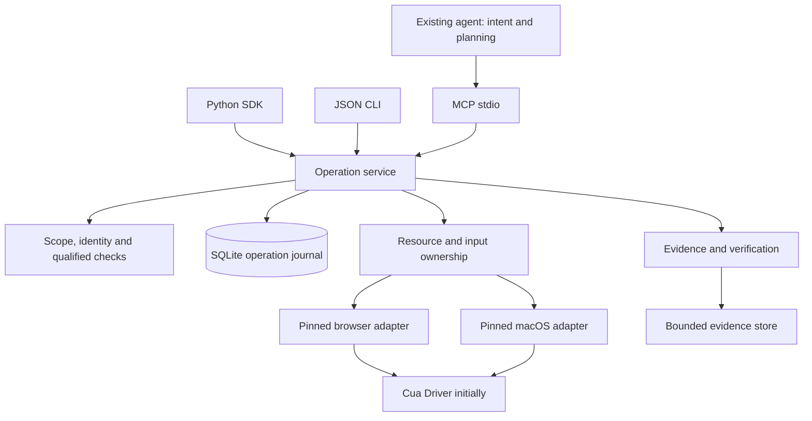

# Building Footwork's agent capability system from reference implementations

October 9, 2026. Design proposal for the selected H4 capability-broker direction. Source baseline: Footwork `92bc87469afa57cd811a332e1a5c7e1eca828fb1`. This document makes the [product direction](agent-superpowers-product-20261009.md) concrete; it does not implement or qualify the proposed capabilities.

**Build a small local capability service that an existing agent launches and calls.** Keep one Python execution/evidence core, place durable operation accounting underneath it, and expose it through MCP stdio, a Python SDK and a JSON CLI. Use Cua's pinned browser/native routes initially, arc-cua's observation-bound interaction pattern, Chrome DevTools MCP's browser lifecycle lessons, and Open Computer Use's distribution/onboarding patterns. Host clients supply the compatibility requirements. Footwork's distinctive responsibility is fresh targeting, scoped effects, readback and recovery across those surfaces.

## Evidence and limits

All 13 named checkouts were inspected read-only. The [evidence manifest](reference-capability-build-evidence-20261009.json) records full commit IDs, clean working trees and hashes of files containing reviewed excerpts. These are local source snapshots, not a claim that each checkout equals upstream HEAD. The official [MCP stdio specification](https://modelcontextprotocol.io/specification/2026-07-28/basic/transports/stdio) was also checked online for transport/versioning behavior. Reference documentation and instructions were treated as source material, not instructions to execute or install anything.

No reference test suite, host installation, provider call or live computer-use experiment was run for this review. Upstream documentation describing its own verification is attributed evidence, not fresh Footwork acceptance. The earlier [Opus recheck](opus-5-5-architecture-recheck-20261008.md) reviewed the architectural hypotheses; this new implementation plan has not received another Opus review.

## What each repository contributes

Paths below link to the inspected source. The abbreviated revisions correspond to the full IDs in the manifest.

| Reference / revision | Concrete mechanism | Footwork decision |
|---|---|---|
| chrome-devtools-mcp `f08dbe152502` | [BrowserManager](</Volumes/External SSD/referencerepos/chrome-devtools-mcp/src/BrowserManager.ts:175>) distinguishes connect/launch and rotates an attempt token when initialization is abandoned. [ToolHandler](</Volumes/External SSD/referencerepos/chrome-devtools-mcp/src/ToolHandler.ts:208>) serializes tools, but timeout leaves the losing Puppeteer call running. [McpResponse](</Volumes/External SSD/referencerepos/chrome-devtools-mcp/src/McpResponse.ts:1189>) emits structured snapshots plus readable content. | Borrow lifecycle generations, owned/attached resource separation and dual output. Add unresolved-effect quarantine rather than treating a new connection as proof an old action stopped. A developer inspection MCP is a later optional diagnostic adapter. |
| modelcontextprotocol `c518f7a927cf` | [Stdio](</Volumes/External SSD/referencerepos/modelcontextprotocol/docs/specification/2026-07-28/basic/transports/stdio.mdx>) defines framing, shutdown, cancellation and modern discovery. [Tools](</Volumes/External SSD/referencerepos/modelcontextprotocol/docs/specification/2026-07-28/server/tools.mdx:498>) separates structured content and tool execution errors. | Use a maintained SDK with qualified legacy and modern profiles. MCP request identity and protocol statelessness do not replace durable effect identity. |
| browser-use `c75e8476e26d` | [MCP server](</Volumes/External SSD/referencerepos/browser-use/browser_use/mcp/server.py:186>) retains browser sessions and lazily initializes direct control. Its explicit `retry_with_browser_use_agent` route delegates to a separate planning loop. State/screenshot results use text and image blocks. | Keep direct observation/action independent of a model planner. Preserve the current exact upstream pin and contract tests. Do not require its autonomous retry agent or copy prose acknowledgements as verification. |
| arc-cua `6b353039111c` | [Snapshot store and tools](</Volumes/External SSD/referencerepos/arc-cua/src/arc_cua/mcp_server.py:348>) retain bounded snapshots; act names a snapshot/element. Missing snapshots tell the caller to observe again. [MCP replies](</Volumes/External SSD/referencerepos/arc-cua/src/arc_cua/mcp_server.py:579>) carry JSON text and structured content. | Use opaque observation-bound targets and concrete stale/expired recovery. Do not copy the handcrafted protocol implementation, permissive version echo or process-local snapshot counters as durable identity. |
| devtools-protocol `8033bef75997` | [Target](</Volumes/External SSD/referencerepos/devtools-protocol/pdl/domains/Target.pdl:10>) distinguishes target/session identity and emits destruction/crash events. [Page](</Volumes/External SSD/referencerepos/devtools-protocol/pdl/domains/Page.pdl:1533>) reports frame/loader lifecycle. [Input](</Volumes/External SSD/referencerepos/devtools-protocol/pdl/domains/Input.pdl:165>) uses viewport CSS coordinates. | Persist logical resource identity separately from connection handles. Invalidate observations on relevant document/connection changes. Input acknowledgement and page lifecycle are not saved-document proof; never apply screenshot pixels as CSS pixels implicitly. |
| open-computer-use `610bac85d242` | [SandboxAgent](</Volumes/External SSD/referencerepos/open-computer-use/os_computer_use/sandbox_agent.py:23>) owns messages, screenshots, vision/action/grounding models and E2B effects. Grounding takes a fresh screenshot before a coordinate action. | Learn the capture/grounding sequence for a future optional visual routine. Its cloud sandbox and full model loop do not belong in the minimal local capability service. |
| open-codex-computer-use `83a521e54610` | [Build packages](</Volumes/External SSD/referencerepos/open-codex-computer-use/scripts/npm/build-packages.mjs:30>) bundles platform runtimes behind one launcher. [Installer](</Volumes/External SSD/referencerepos/open-codex-computer-use/scripts/install-config-helper.mjs:684>) probes server identity/catalog before DSH profile changes; [installer tests](</Volumes/External SSD/referencerepos/open-codex-computer-use/scripts/tests/install-dsh-mcp.test.sh>) cover idempotency, spaces and conflicts. Its [README](</Volumes/External SSD/referencerepos/open-codex-computer-use/README.md>) explains a stable macOS permission agent and host smoke scripts. | Make the consumer experience a packaged executable plus one registration. Reuse a stable permission owner from the selected backend where possible. Add atomic guarded config replacement; do not assume upstream's direct file writes are atomic or all host installers perform the same probe. |
| opencode `388406238bd5` | [Catalog conversion](</Volumes/External SSD/referencerepos/opencode/packages/opencode/src/mcp/catalog.ts:44>) forwards abort/progress, synthesizes text for structured-only results, and throws text on `isError`. [Code mode](</Volumes/External SSD/referencerepos/opencode/packages/opencode/src/tool/code-mode.ts:109>) prefers structured content. [Local transport](</Volumes/External SSD/referencerepos/opencode/packages/opencode/src/mcp/index.ts:341>) takes a command array, cwd and environment. | Support both ordinary tool and code-mode callers. Recovery IDs/instructions must survive text-only error handling. Use short stable tool names and self-contained schemas. |
| mcp-rust-sdk `4048ac40e958` | [CallToolResult](</Volumes/External SSD/referencerepos/mcp-rust-sdk/crates/rmcp/src/model.rs:3972>) handles modern result discriminators and older responses; [structured constructor](</Volumes/External SSD/referencerepos/mcp-rust-sdk/crates/rmcp/src/model.rs:4155>) emits both JSON text and structured content. [Stdio example](</Volumes/External SSD/referencerepos/mcp-rust-sdk/examples/servers/src/counter_stdio.rs>) logs to stderr and waits on service lifetime. | Use as a contract/reference implementation and a possible later Rust transport wrapper. Do not rewrite the Python core merely to use this SDK. Verify equivalent behavior in the selected Python SDK version before release. |
| hermes-agent `38880bd2f1e9` | [Result renderer](</Volumes/External SSD/referencerepos/hermes-agent/tools/mcp_tool_handlers.py:525>) preserves structured results unless identical JSON was dual-emitted, caps payloads and renders errors as text. [Death race](</Volumes/External SSD/referencerepos/hermes-agent/tools/mcp_tool_handlers.py:382>) distinguishes dead-before-call from ambiguous mid-call loss. [Negotiation](</Volumes/External SSD/referencerepos/hermes-agent/tools/mcp_tool_transport.py:181>) supports both protocol eras with its own fallback policy. | Keep essential recovery information small and at the beginning. Explicitly support text-only images-unavailable operation. Test child death during dispatch; reconnect must not imply permission to replay an effect. |
| codex-cli `47b80571f0d6` | [Protocol mode](</Volumes/External SSD/referencerepos/codex-cli/codex-rs/rmcp-client/src/protocol_mode.rs>) defaults to legacy; modern stdio needs both the modern feature and explicit server marker. [Config](</Volumes/External SSD/referencerepos/codex-cli/codex-rs/config/src/mcp_types.rs:272>) distinguishes startup/tool timeouts. [Result status](</Volumes/External SSD/referencerepos/codex-cli/codex-rs/core/src/mcp_tool_call.rs:1047>) marks `isError` failed. | Ship a compatible legacy startup first and qualify modern discovery separately. Retain result disposition inside the receipt rather than deriving business completion from the host's completed/failed tool badge. |
| cua `9994fc2e41a8` | [Driver interface](</Volumes/External SSD/referencerepos/cua/libs/cua-driver/README.md:42>) separates MCP/CLI agent entry points from native SDK bindings. [Protocol pack](</Volumes/External SSD/referencerepos/cua/libs/cua-driver/docs/mcp-protocol-and-skills.md>) includes exact resource URIs and legacy/modern support. [Output normalization](</Volumes/External SSD/referencerepos/cua/libs/cua-driver/rust/crates/cua-driver-core/src/mcp_result.rs:53>) checks advertised schemas and compatible proxy output contracts. | Keep pinned Cua as the initial low-level browser/native backend. Validate success and refusal output against the same public schema. Ship a small embedded guide, without requiring host-native skill activation. Optional perception remains separately licensed and separately qualified. |
| deepseek-harness `d74326738864` | [Tool bridge](</Volumes/External SSD/referencerepos/deepseek-harness/packages/mcp/mcp-client/src/tools.ts:225>) preserves canonical content/structured results, projects images separately and rejects task-required tools. [Connection](</Volumes/External SSD/referencerepos/deepseek-harness/packages/mcp/mcp-client/src/connection.ts>) fences generations and waits for child closure. [Native provider](</Volumes/External SSD/referencerepos/deepseek-harness/packages/experimental/computer-use-cua-driver-mcp/src/index.ts:62>) retains its reservation through child disposal. | Use base MCP calls for every essential workflow; tasks are optional acceleration. Keep native input ownership through shutdown, and no new owner while old driver closure is unconfirmed. Use its generic MCP plugin first, not a new Footwork-specific planning plugin. |

## Concrete architecture



The core should remain Python first. The project already has `BrowserBridge`, `NativeBridge`, authorizer/verifier, carried values, effect records, field/file readback and a substantial scenario discipline. Extract them behind typed library calls rather than shelling the MCP server into CLI commands and parsing printed receipts. Existing Rust hot paths stay behind their pure-Python twins and equality tests. A Rust rewrite would add migration risk before consumer setup or correctness improved.

Proposed new modules under `jevdual/python/jevdual/capability/`:

| Module | Owns | Existing material to extract/adapt |
|---|---|---|
| `contracts.py` | Versioned requests/results, resource/observation/operation IDs, capability records, typed errors | `session.py` records; native/browser effect types. No CLI parsing or platform imports. |
| `service.py` | `bind`, `observe`, `act`, `verify`, `status`, `release`; dispatch sequence | `session.cmd_start`, `_start_browser`, `cmd_look`, `cmd_do`, `cmd_status`. |
| `journal.py` | Transactions, idempotency, reservations, pending/unknown operations and result custody | Replace effect-critical combinations of session JSON/log files and `grants.load/save/consume`; retain old artifacts as provenance. |
| `resources.py` | Logical identity, connection epochs, resource ownership, native input lock | `SessionState`, `BrowserBridge.attach`, `NativeBridge`; driver attachment contracts. |
| `observations.py` | Bounded projection, opaque offered targets, coverage/geometry, stale detection | `menu_from_semantic`, native menus and rendering, inspection manifests. |
| `policy.py` | Scope attenuation, effect matching, posture, required qualifications and judgments | `authorize`, `grants`, `posture`, `arbiter`; no automatic new exemptions. |
| `evidence.py` | Immutable evidence references, exact values, artifact identity and check results | `carry`, `receipt_for`, `_field_receipt`, `_save_receipt`, file checks. |
| `recovery.py` | Classify unresolved attempts, qualified reconciliation and owed-result collection | Existing pending/readback paths, with explicit crash boundaries. It never plans a new task. |
| `adapters/` | Small backend interface and pinned implementations | Browser/native bridges initially. Optional DevTools inspection and visual providers later. |
| `transports/` | SDK, MCP stdio and JSON CLI serialization over the same service | CLI becomes a caller; direct library results replace prose parsing. |

Keep `capability` independent of model-provider bootstrapping. An adapter reports its real routes and qualifications; a verifier reports which checks it can perform. Missing required judgment withholds the affected operation. Existing Jev roles, thresholds and measured policies remain in force until a registered experiment supports replacement. Baseline model-free routes are a candidate qualification, not a blanket removal of the current judge. Current behavior needs an explicit migration: `cmd_do` only creates a judge when credentials are available, and `Authorizer.check` enters its judgment branch only when `self.judge is not None` ([authorizer](../../python/jevdual/authorize.py:211)). Missing access therefore currently differs from an invoked judgment that fails. Establish a matrix of structurally qualified, judgment-required and unavailable routes, with absent/failed/invalid judgment tested separately. This source review did not remediate or reproduce that behavior.

The operation service owns semantic facts. MCP, CLI and SDK may format or project those facts but cannot reinterpret “sent” as “saved,” hide an unknown effect or manufacture a verified target. Transport annotations are hints to hosts, not enforcement.

## Public interface: intuitive through offered choices

Start with seven stable tool names: `capabilities`, `bind`, `observe`, `act`, `verify`, `status`, `release`. The number is a proposed first contract, not a success metric. Surface-specific operations appear as offered moves in observations; the catalog does not need a different tool for every driver method.

| Call | Minimum useful arguments | Returned facts |
|---|---|---|
| `capabilities` | Optional surface/resource | Executable routes, platform/permission state, required judgments, schema version, limits. Safe before a model key exists. |
| `bind` | Task scope reference; explicit URL/new browser or selected app/window/tab; mutation token if creating a resource | Opaque resource handle, ownership, actual capabilities, initial observation or a selection prompt. |
| `observe` | Resource; optional query/detail/screenshot | Observation ID, offered opaque targets/moves, readable values, coverage and source identity. Filtered output does not imply omitted controls are absent. |
| `act` | Resource, observation, offered target/move, typed arguments, client operation token | Durable operation ID, delivery facts, fresh observation/readback where available, checks and permitted recovery. |
| `verify` | Resource/artifact plus a declared supported assertion or prior operation | Which check ran, its evidence and `passed/failed/unknown/unsupported`; visible state and persistence remain distinct. |
| `status` | Operation ID/client token, or task to list unresolved operations; optional reconcile | Current durable result. Readback reconciliation can change knowledge, but does not repeat the requested effect. |
| `release` | Owned resource/session; mutation token | Detached vs closed resource facts, remaining unresolved effects and retained obligations. Never close externally owned apps/tabs merely because the transport ended. |

For example, an observation can offer `target: t_42`, label `Invoice total`, readable value, and `target: t_43`, label `Report body`, moves `fill/append`. An agent selects those handles; it does not reconstruct selectors, AX paths or coordinate transforms. A changed target returns a fresh observation and says whether anything was sent. Similar labels are not sufficient evidence to transfer an approval after drift.

Use an object result envelope in both protocol eras, short names, self-contained JSON Schemas and explicit schema versioning. Keep common top-level arguments easy for model callers; perform joint move/argument validation in the service. Do not expose arbitrary JS, shell, raw driver calls or unrestricted pixel coordinates through the ordinary capability interface. Specialized inspection/execution routes require separately declared authority and readiness.

Illustrative result, not a live API:

```json
{
  "schema_version": "1",
  "operation_id": "op_8c1",
  "client_operation_id": "host-call-17",
  "disposition": "unknown_effect",
  "delivery": {"attempted": true, "confirmed": "unknown"},
  "observed_change": "unknown",
  "checks": [{"kind": "field_readback", "status": "unknown"}],
  "recovery": {"tool": "status", "operation_id": "op_8c1", "reconcile": true},
  "summary": "The connection ended during append. Inspect op_8c1 before requesting another append."
}
```

Emit the compact envelope as JSON text and `structuredContent`, with optional image blocks after it. Larger menus/artifacts use bounded projections and exact evidence references. The recovery ID and delivery uncertainty belong at the front; they must remain useful after host truncation, image rejection or loss of structured errors. Match schemas for success, refusal and unknown results. A recorded unknown disposition is not an assertion that the action failed; `isError` describes the tool's execution contract, not business fulfillment. Actual validation/unsupported execution errors still use `isError: true`, with recovery information duplicated in text.

Task/resource authority comes from the configured launch scope and the host's delegation. Model-supplied `task_id` or `approved: true` cannot create stronger authority. Bind may attenuate that scope. Initial onboarding can use a documented fixture scope; it must not silently expose every app/profile/file. Stdio is a trusted local host integration, not containment against a malicious agent running as the same user. Keep the broader human-control/retained-decision obligations from the Legible Loop in the policy boundary, without introducing confirmations for effects already authorized in scope.

### Task issuance and continuation

Make task establishment part of `bind`, with a no-effect establishment mode when resource selection is still needed. Issue an opaque task handle against a trusted launch principal/profile and its configured maximum scope; record delegated resources/effects, disclosure, posture, limits and required judgments as an immutable envelope. Host `clientInfo` strings and task prose are not authentication. Handles are service-issued references checked against that authority, not permission to read an arbitrary session path.

First-version continuation requires the issued handle and a compatible trusted launch principal/profile. A new conversation may reattach to that task but retains its consumption, reservations, pending operations and owed results. Closure revokes new effects at the next dispatch boundary while permitting authorized readback/result collection. Amendments create linked attenuated tasks; they cannot reset aggregate accounting or discard unresolved obligations. Cross-principal transfer remains unavailable until a real caller requires and qualifies it. Required continuation credentials/reference custody are protected by the host integration; do not log them as page evidence.

Store state under a stable per-user application data root, for example macOS `~/Library/Application Support/Footwork`, with private permissions and opaque-ID lookup. The current cwd-relative `runs/session` fallback is not a reliable MCP state location. Process transport, a guessed task ID or a directory name alone cannot authorize scope expansion or successor access. Within the stated trusted same-user deployment this is a mediated authority boundary, not OS containment.

## Durable effects: the part upstream transports cannot supply

The current `session.cmd_do` dispatches a bridge action before assigning and saving `state.pending`. `grants.consume` reads and writes a separate JSON file. These are source-visible boundaries to replace, not newly reproduced runtime incidents. URL-based browser rebinding also cannot establish document identity across reconnects; current driver tab IDs are connection-local. See [session](../../python/jevdual/session.py), [grants](../../python/jevdual/grants.py) and [browser bridge](../../python/jevdual/browser_driver.py).

Driver exception classification also needs phase evidence. `cmd_do` catches `NativeBridgeError`/`RuntimeError` as “not dispatched”; that type alone cannot establish no side effect. For example, native key preparation can click a title bar before raising `not_key` ([native preparation](../../python/jevdual/native.py:1065)). Record preparatory input/foreground changes as part of the governed attempt, even if the principal key was never pressed. The adapter must report which effect boundary was crossed; generic exceptions after an uncertain boundary remain unknown.

Use one SQLite database for mediated operation state, with explicit schema migrations, foreign keys, WAL and a reviewed durability setting. Tables should include tasks/scopes, logical resources and incarnations, observations/targets, grants, budget reservations, operations/attempts, evidence/checks, and owed/collected results. Large captures stay in a bounded private file store with digests; store references in the database. Schema/key versioning and retention must preserve unresolved effects and required result custody.

Dispatch sequence:

1. Validate scope, capabilities, operation token and request digest. Uniqueness is `(delegated scope, client operation token)`. An identical repeat returns the original operation; a changed payload with the same token is an error. Caller tokens must exist before dispatch, so a lost first response is recoverable. Also permit listing unresolved operations by task.
2. Acquire the necessary logical-resource and, for affected native/global-input routes, machine-input ownership. Reobserve and establish exact target/preconditions within the governed operation. A stale/ambiguous target dispatches nothing. Avoid a long database transaction while awaiting a model or driver; reservations plus a final transactional recheck mediate intervening changes.
3. Commit intent, immutable arguments/effect digest, observation/resource incarnation, grant use and task-owned reservation. Commit a conservative `dispatching` attempt before the external driver call. A crash after this marker is potentially sent even if the call never reached the OS. The extra ambiguity is preferable to an unrecorded effect.
4. Dispatch once to the exact bound adapter route. Record what the adapter actually knows: not sent, rejected, acknowledged delivery or ambiguous. A delivery acknowledgement alone does not prove an expected state change.
5. Settle/reobserve within a bounded deadline, run supported checks, commit evidence and final/pending disposition. Persist result custody before replying. Render model-facing text from this record.
6. On transport cancellation, stop queued undispatched work and stop waiting when appropriate. Already sent work is reconciled, not rolled back by assertion. The transport may suppress a canceled response as its protocol requires; the journal still retains status for a later call.

**Do not promise exactly-once GUI effects.** SQLite and the browser/OS do not share a transaction. Footwork can prevent its own blind redispatch, preserve accounting and distinguish unresolved work, but it cannot erase uncertainty or stop external applications/other tools from acting.

Broker/connection epochs fence stale callbacks from installing resources or overwriting newer results. They cannot physically fence a late Puppeteer or native effect unless the adapter has that capability. Retain resource quarantine until the old action is reconciled or its stopped/not-sent state is established. A process crash, lease expiry or successful reconnect is insufficient to clear unknown effects. When no reliable readback exists, report the remaining uncertainty and the necessary retained decision.

Initially serialize mutation per logical resource, and global input where required, across broker processes using shared ownership plus OS process locks. A database lease alone is insufficient. Confirm old driver/process teardown before transferring input ownership. Observations may run concurrently only on routes whose isolation is qualified. If another same-user tool bypasses Footwork, assurance is limited to mediated effects and detected external drift.

Long settling should return a normal bounded result with an operation ID and `pending` status, then use ordinary `status` calls. No essential workflow requires MCP task support. Work may continue only within the original operation while its owning process remains alive; exiting preserves unresolved state, not a claim of unattended liveness. MCP transport “complete” means its RPC returned, not that the business task is fulfilled.

## Browser and native adapter contracts

Define `capabilities`, `bind`, `observe`, `validate_target`, `dispatch`, `readback`, `reconcile`, `detach` and `close_owned` as the narrow backend interface. Adapter replies carry connection/resource identity and delivery facts; they do not supply an overall task verdict.

**Browser:** prefer a dedicated isolated profile for the first supported onboarding task. Attaching to an existing authenticated profile is a distinct explicit capability. Do not choose an arbitrary available debugging port or logged-in tab. Remember ownership, selected target, connection epoch and available frame/document incarnation; invalidate targets on relevant navigation/crash/reattachment. Treat URL/title only as selection hints. If the pinned driver cannot preserve sufficient identity, refuse continuation and qualify the necessary seam extension through its contract tests. Do not silently bump Cua or add raw CDP fallback.

Chrome DevTools MCP demonstrates both profile discovery and lifecycle hazards. Its slim navigation handler can automatically accept a `beforeunload` dialog: that is not a neutral default for Footwork's retained-decision policy. Preserve unresolved dialogs and unsaved-work choices unless the task scope covers the specific effect. Browser telemetry, diagnostic logging and arbitrary JS evaluation also require deliberate product choices; do not import their defaults into the core.

**Native macOS:** bind selected application/process/window incarnations, then AX observation and offered routes. Background AX and foreground/key/pixel operations declare distinct posture and interference properties. Reuse the selected backend's stable signed permission owner where possible; otherwise qualify a minimal companion that owns permission/runtime identity. It owns no agent plan. Permission grants remain OS/user actions. Teardown detaches Footwork sessions and owned helpers, preserving externally owned apps and owed outcomes.

**Visual:** retain capture identity, frame geometry, scale/coordinate space and one-use action binding. Model-proposed regions are observations/judgments, not grants. Host image resizing makes unqualified coordinate reuse invalid. Current Footwork native visual checks remain advisory; browser geometry, pixel execution and perception quality are later qualification packages. An unavailable visual route returns a capability limit rather than quietly bypassing AX/DOM checks.

**Cross-surface values and files:** promote existing carry provenance into typed value references tied to source evidence and scope. Append/fill can consume a reference without repeatedly exposing its contents in logs. Verify the exact destination field/artifact using a declared supported check. Save-copy, save-in-place, browser download and remote publication have different identities/effects; do not collapse them into universal `save`. Never derive persistence from a screenshot or text saying “submitted.”

## Distribution, setup and host integration

The release artifact should give consumers a platform command without compiling Rust or configuring model providers for basic diagnostics. Keep the existing `footwork` entry point during migration. Public package names/versioned installer commands are proposals until namespace/release checks succeed; do not advertise a nonexistent `pip install footwork` or npm package.

1. Ship prebuilt wheels for existing native/Rust components plus a macOS runtime distribution containing the pinned backend and launcher. Split optional heavy browser/model/native capabilities behind explicit dependency groups or distributions. Changing the current Maturin build to an optional extension requires equality and installation checks; it is not a cosmetic metadata edit.
2. `footwork doctor --json` reports platform/runtime/hash, permission state, available browser choices, adapter versions, host registration and supported checks. It should work without secrets or model initialization and distinguish missing configuration from unsupported behavior.
3. `footwork setup --host <host> --dry-run` locates the host's actual configuration and proposes one command registration. Probe executable/server identity, advertised schemas and exit behavior before writing. Handle paths with spaces using argument arrays. Registration does not itself authorize task effects.
4. Applied setup preserves unrelated settings/comments as supported by the format, refuses conflicting unmanaged identities, saves a recoverable prior version and atomically replaces only the expected revision. If concurrent edits occur, re-read and rebase the specific entry instead of clobbering them. Idempotent setup and targeted uninstall are required. Multi-file formats need an explicit staged/rollback sequence; atomic rename of one file is not a transaction over several files.
5. Perform OS permission onboarding only for missing required permissions. Network dependency/browser downloads and account/provider setup are explicit authorized actions. Browser attachment and existing-profile authority are visible choices. Avoid a mandatory Footwork account or provider key for launching the tool and discovering its limits.
6. Bundle a concise resource guide with exact URIs and content hashes. The basic flow works from tool descriptions and ordinary resource reads. Host-native skill installation is optional and separately visible; MCP resource discovery does not automatically activate a skill.

Qualify one host at a time, then repeat the same suite across Codex, OpenCode, Hermes, DeepSeek Harness and Claude Code. The first four have concrete caller evidence in this review; Open Computer Use's Claude installer/smoke harness is a starting reference, not direct inspection of Claude's private implementation. Record exact host/runtime/protocol versions.

| Host concern | Acceptance that matters |
|---|---|
| Startup/protocol | Server identity and tool catalog work under legacy negotiation; modern profile has separate transcripts. No log noise on stdout, no startup dependence on model credentials, EOF teardown confirmed. |
| Schema/results | Success/refusal/unknown envelopes validate. Essential operation ID/recovery survive text-only errors and output truncation. Normal calls and code mode agree on semantic facts. |
| Images/resources | Image-capable and text-only routes both receive useful output; no claim a model saw an image the host rejected. Exact guide/evidence references resolve within scope. |
| Timeout/cancel/restart | Death before vs during dispatch, canceled settle and lost first reply preserve accounting; reconnect/status never duplicate a submission or append. Native ownership remains held until closure/reconciliation is established. |
| Setup | Clean install and existing configuration both work; repeated setup is unchanged; spaces/conflicts/concurrent edits are handled; rollback restores unrelated entries. |

## MIT scope and dependency boundaries

Footwork's root/package licenses are already MIT. Retain MIT for authored core/API/SDK/examples and preserve each shipped component's own license/notices. The inspected root licenses are MIT for browser-use, arc-cua, open-codex-computer-use, OpenCode, Hermes, Cua core and DeepSeek Harness; Apache-2.0 for Chrome DevTools MCP, open-computer-use and Codex; Chromium BSD-style terms for devtools-protocol. MCP specification/Rust SDK roots explicitly describe a transition from MIT to Apache-2.0, with some legacy contributions remaining MIT and non-spec documentation CC-BY-4.0.

Architecture patterns and using a protocol do not require copying an implementation. Copied code and redistributed dependencies retain their applicable obligations. Produce a distribution component/license manifest from the exact shipped artifacts, including bundled browsers/backends/model components; the local root-license inventory is not that release audit. Keep Cua's optional AGPL perception component outside the default MIT core distribution. Optional model/provider services are separately configured. If “every shipped component must be MIT” becomes a requirement, that changes dependency/distribution choices beyond merely keeping Footwork's own code MIT.

## Executable migration sequence

Implement as small reviewable packages after this design is selected. Preserve the existing commands and results provenance until each replacement is qualified. Any new empirical question/test/harness work follows CONTRIBUTING's notebook and preregistration rules; commit predictions before tests resolving them.

| Package | Deliverable and qualification | Recovery / boundary |
|---|---|---|
| 1. Typed core extraction | Service results for bind/look/do/status and field/file checks; old CLI calls the service. Specify task issuance/continuation, judgment-route matrix and result semantics with actual callers. Scenario fixtures establish equivalent permitted/refused behavior except deliberately registered policy corrections. | Keep old read-only artifact readers; avoid two active mutation paths. No packaging/protocol changes yet. |
| 2. Journal and ownership | Migrate effect-critical state, grants/reservations and result custody. Inject crashes before/after each commit/dispatch/reply; same-token repeats return one record, changed-token payload conflicts refuse. Exercise two processes and late callbacks. | Database migration backup/version gates; unknown operations block conflicting effects. Do not fall back to old JSON mutation accounting after a new-schema effect. |
| 3. MCP + SDK + JSON CLI | All entry points use the same service; schema round trips and identical dispositions. Legacy interoperability first, modern separately gated. Capability discovery works offline without keys. | Existing CLI invocation remains available. Feature flags cannot bypass journal/policy. |
| 4. First release package | Clean macOS install without consumer compilation, pinned adapter artifacts, stable permission identity, doctor and one host setup. Browser/macOS capability matrix and license manifest included. | Recoverable config installation; no autonomous system/network edits. Missing routes give actionable diagnostics. |
| 5. Real host qualification | Existing agent reads a fixture browser value, carries it into a scoped native document, saves a new copy where supported and reads the exact artifact back. Repeat with stale targets, duplicate tabs, process death and permission loss. Compare each host's projected results. | Retain failures/unsupported checks; no live-heldout debugging. Host bypass remains outside assurance. |
| 6. Optional expansion | Additional hosts/platforms, DevTools inspection, qualified visual moves, bounded routines, optional shared daemon only when evidence shows useful outcome/setup gains. | Each has its own route/permission/cost/qualification gates; default core remains usable independently. |

The first useful release is a packaged browser/macOS capability service with truthful continuation and supported readback. It does not need a new planner, universal computer-use promise, multi-agent resident daemon or rewritten Rust platform stack. Measure fresh-host time to a verified task, configuration decisions, user interventions, target/schema repair, unknown-effect rate, duplicate-effect attempts and time/cost per verified outcome. Compare against current Footwork and direct backend use on preregistered tasks; reference code inspection supplies implementation choices, not those measurements.

Specify contract shape and meaning at the start; freeze the public release contract only after journal/recovery and actual-host gates pass. A schema can describe a proposed guarantee before the service earns it, but that is not yet a release promise.

The immediate build order is **typed service → durable operations/ownership → MCP/SDK/CLI → packaged onboarding → real host qualification**. The current strongest reasons for that order are Footwork's dispatch-before-pending boundary, upstream uncancelled browser effects, host result degradation and process-owned native input. Those facts make recovery and caller compatibility core design work rather than optional polish.
