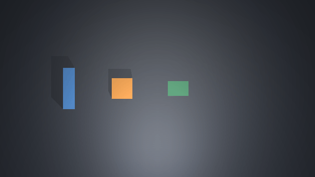

# An AI controls successive simulated bench jobs

The multimodal AI in this Codex conversation completed both preregistered jobs on one bench. It inspected rendered images and authored individual movement, measurement and reset proposals through the new handoff. A saved measurement proposal refused after the diagnostic harness moved the block; the AI inspected the changed image, chose corrective motion, and completed measurement and reset.

Frozen source: `9a5d2f8bfac8088b13c63052887e0c0c2e9d5c7e`. This was one frozen trial attempt. No deterministic coordinate planner or native-pose input guided the AI. Bench, measurement-worker, native-motion and image-guard source stayed unchanged from SIM6.

## What was tested

The [visual AI handoff](../../../tools/physical-workcell/AGENT_BENCH.md) binds immutable image challenges to typed proposals, retains dispatch intent, routes actions through the existing bench, and returns results and observation snapshots. CLI responses filter detector coordinates from measurement/status receipts. Full private records remain available for post-trial scoring.

The AI received task regions, pusher dimensions and calibrated images. It selected every target in this conversation and inspected a new image after each dispatch. Tool orchestration saved and dispatched those choices; it contained no action-selection loop or automatic fallback policy. The actual host was this Codex assistant, not an unattended provider-backed process. No API key or new provider was used.

The model supplied 29 proposals. The host presented 31 images through `view_image`, including initial observations for both jobs. Every proposal binds a challenge whose image digest appears in the presentation record. There were 28 executed proposals, one expected stale refusal, and no unknown outcomes.

## Results

| Job | AI motion actions | Measurement generation | Reset generation | Reset contact samples | Result |
|---|---:|---:|---:|---:|---|
| Ordinary | 10 | 2 | 10 | 3,174 | Completed |
| Disturbed | 12 | 15 | 23 | 3,206 | Recovered and completed |

One bench ID, `3e025aca6ea240f29003b7c6fdc91a39`, spanned both jobs. Native time advanced from 1.000 s to 25.080 s to 57.032 s. Job two started from the exact generation/time retained by job one's verified reset. Both resets used native contacts and returned the block and pusher home.

Separate native scoring found block x=0.06583 m at the first measurement and x=0.07880 m at the recovered measurement, inside their respective target regions. Read-only SQLite scoring confirmed exactly one measurement per job with matching image/state identities. Both measurement subprocesses exited with code 0. The final bench was idle with no unresolved effects.

Evidence: [native/SQLite score](native-sqlite-score.json), [AI action audit](AI-action-audit.json), [image presentations](image-presentations.json), [source hashes](source-freeze.json), [cleanup](cleanup.json). The complete private session and integration-state history remain in `tools/physical-workcell/output/sim7-ai-20261011-v1/`.

## Disturbance recovery

The AI saved its second-job measurement proposal at generation 12. Before dispatch, the harness applied a -1.5 N external force for 80 native steps, followed by settling. Generation 13 retained the changed state with the force cleared. Post-trial scoring measured a -0.13303 m displacement along x and found the block outside the measurement region.

The original proposal was refused as stale. Its returned observation showed the displaced block. The AI proposed a corrective push from that new challenge, inspected the result, retracted the pusher and issued a new measurement at generation 15. It then chose the reset route and requested independent completion verification at generation 23.

The guard refused the stale measurement before computer dispatch. This was a deliberately injected, preregistered disturbance; the AI knew a disturbance trial was planned. It is not a blind benchmark or a general recovery-rate estimate.

## Verification and limits

Fifteen handoff tests and fourteen unchanged-bench tests passed. They cover exact replay, foreign/stale evidence, source and receipt tampering, phase rules, filtered model inputs, failed measurement workers and a lost host reply after actual native motion. The latter retains an unknown result and blocks future dispatch even when the underlying bench is ready. See [checks.json](checks.json). Ruff, notebook validation, diff checks and result redaction also passed.

The separate scorer ran only after both AI-controlled jobs finished. It checked historical measurement placement, current reset positions, contact evidence, native time/generation continuity, SQLite persistence and unchanged source. Presentation records document images emitted to the AI host; the host-role label alone is not model authentication or cryptographic proof of model origin.

This qualifies the interface and this AI session's two-job behavior in the narrow simulator. It does not qualify an unattended model service, other model policies, arbitrary objects or disturbances, continuous wall-clock physics, real cameras, instruments, actuators or production Footwork capability governance. Unknown interrupted effects stop new dispatch; they are not automatically repaired.

## Replay

Orange is the block, blue is the pusher, and green is the task region. The replay contains recorded observations rather than interpolated motion or continuous video. It pauses at the displaced frame during the second job. [Frame identities](frames.json) preserve the original image digests.

To reproduce, use the handoff guide in a checkout with the frozen source and a fresh private bench/session. Supply the task and images to a multimodal host, retain every proposal and outcome, then invoke `score_agent_bench.py score --run-dir RUN_DIRECTORY` after control ends. The scoring command checks physics and persistence; it does not manufacture or run an AI policy.
