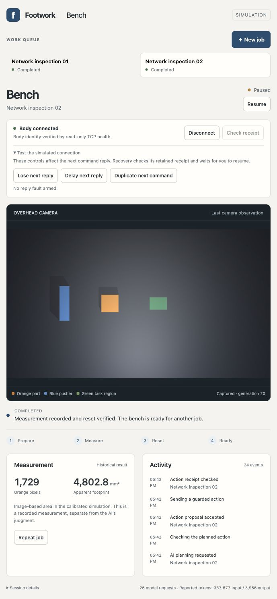

# Browser workbench on a persistent body

The first frozen browser/model trial passed. Two successive actual Codex jobs used camera images downloaded over TCP, recorded one measurement each and reset by contact on the same simulated body. A lost motion reply visibly blocked the queue. Disconnect and reconnect sent no commands; receipt lookup recovered the original result without resending its action and left the agent paused until explicit Resume.

Measured source: `d731ac8ea03f326edef18ea9c1b9cb2027421871`, unchanged throughout qualification. The preregistered experiment is [SIM10](../../docs/experiments/SIM10-network-workbench.md); the full independent result is [qualification-score.json](qualification-score.json).

| Job | Model calls | Measurement generation | Reset generation | Native time at reset | Reset contact samples |
| --- | ---: | ---: | ---: | ---: | ---: |
| Network inspection 01 | 13 | 2 | 10 | 21.814 s | 3,174 |
| Network inspection 02 | 13 | 12 | 20 | 42.562 s | 3,254 |

The independent scorer ran after both owned trial processes exited. It checked native placement and home snapshots, continuous native time and generation, exact SQLite measurement receipts, image digests, model process exit, typed proposals and core receipts, single client sends and the browser transition ledger. All passed. The planner and browser host had no native state access. Reload retained both completed jobs and all 80 client command records without another command.

The browser also exercised an exact duplicate and a 0.8-second delayed dispatch reply. The duplicate produced two upstream forwards, equal retained replies and one client send; the body/core receipt bound the result to the original command. Each diagnostic fault was consumed once. See [fault observations](fault-observations.json). The recovery controls blocked receipt lookup while disconnected. The visible Resume snapshot was captured immediately after the click; its public-state ledger was recorded later while the successive jobs were still running.

Conformance passed 94 checks: fourteen real-socket runtime checks and eighty core, adapter, fault-matrix, link and HTTP checks. Ruff, JavaScript syntax, notebook schema and authenticated CLI preflight passed. Earlier failures and fixture corrections remain in [retained development attempts](retained-development-attempts.json); the one actual-model attempt is in [attempt-ledger.json](attempt-ledger.json).

After scoring, the same roots and ports were restarted for handoff. Body and application identities, completed history and the 80-command journal persisted. The host is paused with no active job or pending model request. The browser is at `http://127.0.0.1:51377/`; the body is at `http://127.0.0.1:51373`. Handoff process ownership is recorded in [handoff.json](handoff.json). Use New job or Repeat job, then Resume. Connection diagnostics remain visible.

This qualifies same-Mac loopback simulation. Physical hardware and authenticated control across machines remain untested. Pause blocks later admissions; an already admitted bounded action may finish. Queue, model and command budgets are finite. Run and restart instructions are in [NETWORK_WORKBENCH.md](../../../tools/physical-workcell/NETWORK_WORKBENCH.md).

