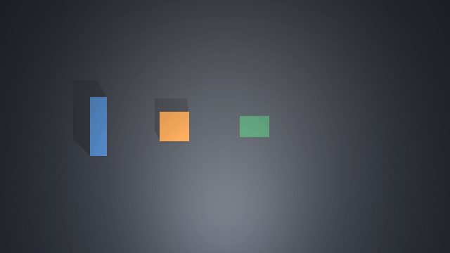

# Successive experiments on one simulated bench

Frozen source `0091e5f832a3aef24ef73fdc9f1ee76bd64b7e46` completed both preregistered cycles on their first qualification attempts. Each used RGB-guided preparation, a separate computer measurement process, and contact-driven reset. The second recovered after an external force displaced the block by 0.1333 m along x.

## What ran

The actual [bench CLI and host](../../../tools/physical-workcell/BENCH.md) ran with pinned MuJoCo 3.15.0 in its existing environment. The host chose motion from exact rendered PNGs and public task data. No native pose guided it. Separate native-state scoring inspected historical measurement and reset states; read-only SQLite scoring checked saved computer results.

From a checkout at the named source commit:

```sh
tools/physical-workcell/.venv/bin/python tools/physical-workcell/qualify_bench.py \
  --output tools/physical-workcell/output/sim6-qualified-20261011-v1 \
  --source-commit 0091e5f832a3aef24ef73fdc9f1ee76bd64b7e46
```

Use a new output directory for another attempt. Both host processes exited with code 0. The source matched the named commit before and after the run. [Source hashes](source-freeze.json), [qualification](qualification.json), [fresh-process status](fresh-cli-status.json), and [cleanup](cleanup.json) are retained. Full private journals and integration states remain in `tools/physical-workcell/output/sim6-qualified-20261011-v1/`.

## Outcomes

| Job | Motion actions | Measurement generation | Orange pixels | Reset generation | Reset contact samples |
|---|---:|---:|---:|---:|---:|
| Ordinary | 29 | 11 | 1,724 | 29 | 6,619 |
| Disturbed | 40 | 52 | 1,723 | 70 | 6,663 |

Reset contact counts above come from motions labeled `contact_reset`, separately scored from the host journal. The controller's reset receipt also counts contacts from other reset-phase parking motions. All motion actuator-force maxima stayed within 4 N per axis.

One bench ID, `92d5adce82a146aeb8df71651fa03959`, spanned both jobs. Native time advanced from 1.000 s to 45.398 s to 107.936 s. Job two began at the exact generation/time left by job one's reset. Integration state was restored between calls and never reinitialized between jobs.

Separate native scoring found block x=0.06765 m at the ordinary measurement and x=0.06769 m at the recovered measurement. Both reset states placed the block within its home region and the pusher at x=-0.30 m, y approximately 0.

The measurement worker computed apparent orange footprint areas of approximately 0.004789 and 0.004786 square meters from the simulated orthographic camera. SQLite contained exactly one row per job. Repeating each measurement operation returned its identical historical receipt without another worker or result.

## Recovery and guards

The second job reached preparation generation 40 before a -1.5 N diagnostic force was applied for 80 native steps, followed by bounded settling. Generation 41 retained the changed state with the force cleared. The public RGB center changed by 0.1333 m. Both stale-image effect requests refused, leaving durable public state unchanged. Fresh-image recovery motions established placement before measurement at generation 52.

| Required criterion | Evidence kind | Evidence | Result |
|---|---|---|---|
| One body across successive jobs | Historical continuity | Both score files and fresh CLI status | Passed |
| Preparation before measurement | Historical state | Separate native measurement-state scores | Passed |
| Exact computer result persisted | Current saved state | Read-only SQLite scores and receipt equality | Passed |
| Stale disturbance evidence rejected | Historical effects | Disturbed journal and recovery score | Passed |
| Fresh-image contact recovery | Historical motion | Recovery-purpose native receipts and placement | Passed |
| Contact reset before next job | Historical and current state | Contact steps, reset scores, next-job start | Passed |
| Final bench idle, evidence retained | Current state | Fresh CLI status and cleanup | Passed |

Fourteen final-source conformance tests passed in 4.266 seconds: replay/conflict semantics, job phases, measurement readback, stale evidence, corrupt source/state/image/model/measurement/SQL bindings, and interrupted-intent refusal. See [conformance.log](conformance.log). Ruff, the notebook checker and diff checks also passed.

## Recorded observations

The replay contains recorded observation frames, not interpolated trajectories or continuous camera video. Orange is the block, blue is the pusher, and green is the measurement region. The displacement occurs during the second cycle. Exact frame digests and RGB positions are in [frames.json](frames.json).



## Limits and next boundary

This verifies a deterministic color-specific RGB policy on one simulated axial disturbance and two successive jobs. It does not verify language-model planning, arbitrary objects, non-axial recovery, continuous wall-clock physics, hardware, power-loss recovery or a production Footwork capability adapter. Unknown interrupted effects block dispatch and are not automatically repaired. Physical placement and computer persistence are separate operations.

The next extension is a host-facing prepare-measure-reset task with different measurement requests and the same bench ownership and evidence contract. A model can propose a bounded next action through the image interface; the controller continues owning freshness, limits and verification. Instrument and real actuator adapters remain future work.

Development evidence remains under `output/sim6-backend-probe1/`, `output/sim6-root-dev1/`, and the conformance fixture directories. Guard refinements preceded the freeze. No physics/controller settings were tuned against this qualification, and no qualification attempts were retried.
