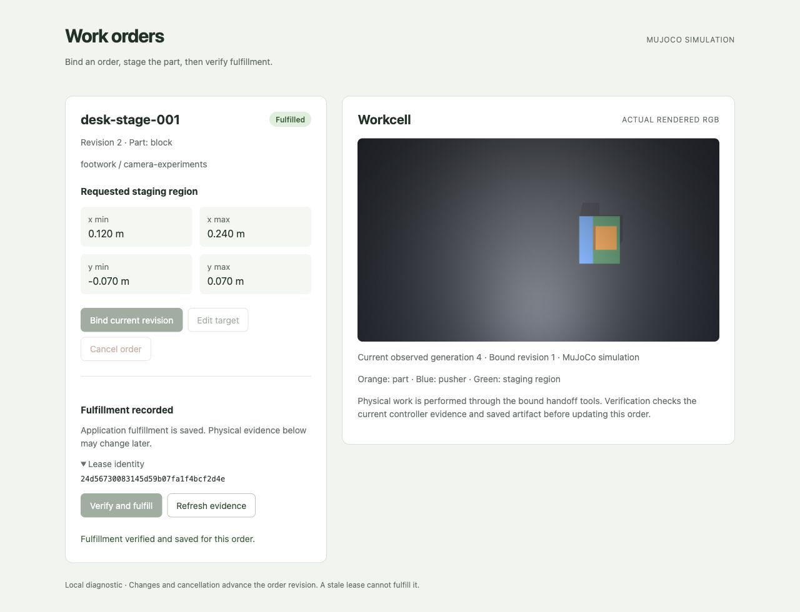

# SIM5: Versioned application and simulated physical fulfillment

The corrected implementation completed the actual browser/physical/application loop and
all seven independent integration scenarios on frozen commit `bd896e1`. The affected
95 checks passed. This is a local diagnostic, not hardware, production browser governance
or autonomous policy qualification. Source, outcomes and verification are recorded in
`source-freeze.json`, `summary.json`, `browser-result.json` and `verification.json`.

## What connects

A Python/SQLite loopback app records an order and its revision. The browser binds one
immutable lease for that revision, including the exact task and stable physical/application
completion identities. A separate handoff CLI owns or reconnects the assigned controller
through public commands. The agent observes rendered RGB and supplies bounded proposals.
The app verifies the assigned staged history, current image/task binding and saved artifact,
then updates the same still-open revision and saves one fulfillment receipt in a transaction.

Editing or cancelling advances the revision. A guard withholds subsequent submissions and
requests cooperative cancellation of an owned active operation. Previously admitted motion
can be partial. The guard must be called by the host; this package has no background watcher
or atomic transaction joining native motion and application state.

## Development evidence

The earlier controller/body/vision files retain their SIM4 hashes. Their 68 affected tests
passed: 18 process/controller tests and 50 workcell, image-guided, case and episode tests.
Commands and timings are recorded in `verification.json`.

Root source review found that a cached browser checked the responding app identity after
POST, leaving same-origin replacement writes unbound to the original app. Prediction
`46aa8f4` preceded the real mutation regression. Both pre-fix subcases failed: an absent
expected app identity edited the row, and a valid foreign app identity cancelled it. Private
before/after rows and the failed parent result remain at
`tools/physical-workcell/output/a56bb315a/conformance.json`.

The corrected server requires one exact `X-Footwork-App-ID` before every mutation. The
browser sends its retained app identity. Valid order/lease references and exact Origin/Host
are separate requirements.

The first malformed-receipt attempt stopped before its intended check when an overlapping
UI change invalidated the bound source. A fresh fixture then exposed three falsely accepted
reconciliation variants after controlled private-store corruption: boolean leased revision,
cancelled current order and a current revision older than the receipt. Both logs remain under
`output/h5-receipt-before-type-fix*/`. The final adapter requires strict typed receipt fields,
the same canonical task and a fulfilled current order at or after the recorded revision.

Final app conformance passed 16 tests in 38.746 seconds; final adapter conformance passed
11 tests in 37.086 seconds. Their exact source/evidence paths are in `verification.json`.
Earlier controller regressions account for the other 68 checks and retain the unchanged
SIM4 hashes. Ruff, JavaScript syntax and notebook checks passed.

## Independent evidence

Root drove an isolated in-app browser against the frozen local app. It read and bound
`desk-stage-001` revision 1. Root inspected native RGB generations 0 through 4 and chose
four bounded moves from the public visual packet. Native receipts recorded 9,890 contact
samples over 3,484 steps. The final image-derived block center was approximately
(0.196, 0.006) m inside the requested region. A fifth admitted completion action staged
the digest-bound software artifact and passed Footwork's current saved-byte check.

The browser's **Verify and fulfill** action then independently checked physical evidence
and saved fulfilled revision 2. Separate HTTP and read-only SQLite verification found
exactly one application receipt for the same app/order/lease/operation. Browser reload
preserved fulfilled revision 2. The screenshot shows the result and actual rendered RGB;
it is evidence from the completed trial, not a current live camera feed.

The independent driver used public app/controller/handoff APIs, a deterministic RGB planner
and separate read-only SQLite scoring. It reused identified frozen transport helpers but
did not call unit-test scenarios. Its seven first attempts passed with unchanged source:

| Scenario | Persisted outcome | Fulfillment effects |
| --- | --- | ---: |
| Normal RGB contact and fulfillment | Revision 4, fulfilled | 1 |
| Edit during admitted motion | Revision 4, open; stale completion refused | 0 |
| Cancel during admitted motion | Revision 4, cancelled | 0 |
| Lost HTTP reply after commit | Original receipt reconciled and repeated after controller stop | 1 |
| Wrong identities, conflicting IDs, client flags/paths, unsupported evidence | Revision 3, open; refused | 0 |
| Same-origin app and controller restart | Unchanged physical generation/state, retained history, revision 4 fulfilled | 1 |
| Changed current artifact with staged history | Revision 3, open; new fulfillment refused | 0 |

Edit/cancel stopped after 179/186 native steps respectively; each verified retained state
matched a fresh public observation. The driver preserved the actual lost-reply socket event
and conflicting committed-ID refusal. Raw evidence remains in
`tools/physical-workcell/output/s5-independent-20261010-v1/qualification.json`, with its SHA256
in `summary.json`. Root's separate browser evidence remains in `output/b5-browser-20261010/`.

All trial-owned app/controller processes exited and owned controller sockets disappeared.
The temporary browser tab closed; persisted order state and screenshots remain. Process
exit is a cleanup observation, separate from the verified native cancellation stop checks.

## Limits and next boundary

Physical proof is checked before the application transaction. Its verification timestamp
and the application's commit timestamp describe that boundary; a later physical/artifact
change cannot be excluded atomically. Historical application receipts remain separate from
current physical integrity. Same-app restart preserves its exact port; origin rebinding and
automatic takeover of externally restarted controllers are unsupported.

The controller still operates one known-color block and pusher in a bounded MuJoCo scene.
Native camera perception, general robot manipulation, multiple agents sharing real hardware,
production capability governance and demand from an operator remain untested.

Each lease owns a separate simulated episode. Successive orders or edited targets on one
persistent physical body, with resource ownership independent of task identity, are the next
useful boundary. This run does not qualify that transition or automatically continue an
interrupted physical job under a new order revision.

Preregistration: `../../docs/experiments/SIM5-versioned-application-fulfillment.md`.
Notebook: `../../docs/notebook/2026-10-10-versioned-application-fulfillment.md`.
