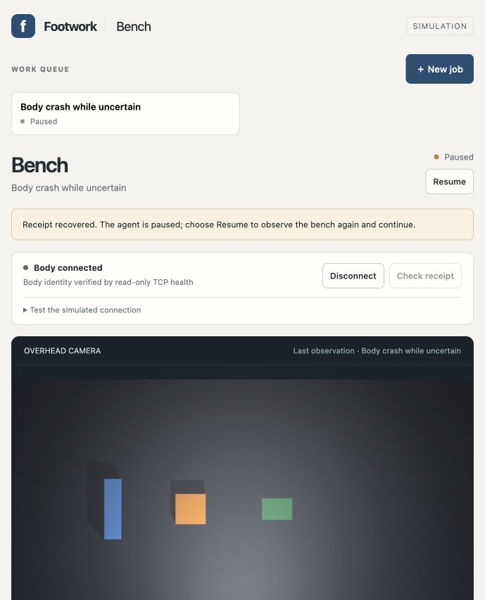
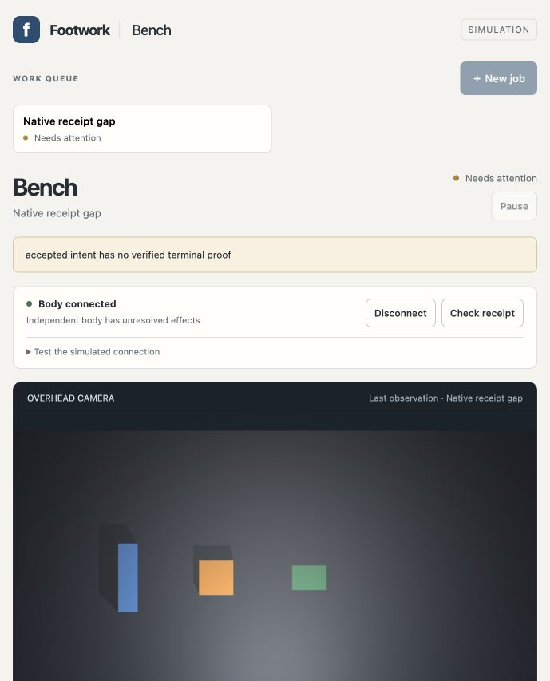

# Hard-crash recovery at command boundaries

Four actual browser cases passed independent post-stop scoring on frozen source `4e2dd74d27ec07f0b5a42039e0f30016402cf050`. Three recovered their original receipts and completed measurement/contact reset. The fourth saved native motion without its completion receipt and correctly stayed blocked. Across the qualified runs, 41 actual image-only Codex decisions and all 127 commands were independently bound to exact TCP evidence, with one wire send and fresh admission proof per command. [Summary](summary.json).

| Hard crash | Browser behavior after restart | Independent result |
| --- | --- | --- |
| [Workbench in flight](host-inflight/hard-crash-score.json), after body completion but before reply delivery | Same original command returned uncertain; Check receipt recovered it while paused; explicit Resume obtained a fresh image | 13 decisions, 40 commands; job completed measurement and reset; body boot stayed one |
| [Body while already uncertain](body-uncertain/hard-crash-score.json) about a completed command | Original boot-one receipt recovered under boot two; runner stayed paused until Resume | 14 decisions, 43 commands; measurement/reset completed; stable body identity and no resend |
| [Workbench while already uncertain](host-uncertain/hard-crash-score.json) | Same pending stage survived SIGKILL; exact receipt recovery preceded Resume | 13 decisions, 40 commands; measurement/reset completed; no command or decision replay during restart |
| [Body native receipt gap](body-native-gap/hard-crash-score.json), after motion/state save but before the lower receipt | Boot two still reported an unknown outcome; two receipt lookups could not release it; continuation and New job were disabled | One decision, four commands; saved next state proves motion, while the original manifest stays busy and no lower completion is indexed |

All four crashed processes exited by SIGKILL, with empty descendant sets at the selected gates and observed process reaping. Every other owned trial process exited zero before scoring. The three recoverable cases kept exactly four commands through crash, restart and receipt application. Fresh work began only after explicit Resume. The native-gap case never admitted a successor. An unfamiliar or apparently correct camera position supplied no completion authority.

The new [controller](../../../tools/physical-workcell/qualify_workbench_crashes.py) retains exact expectations, PID/group ownership, before/offline/restored snapshots, immutable request/reply bytes and cleanup. It signals only its registered fresh simulation processes. Its external relay holds one completed dispatch reply for the in-flight host test. The [diagnostic body launcher](../../../tools/physical-workcell/crash_body.py) exposes the deeper gap immediately before the Bench terminal receipt commit; ordinary body code performs the restart. The [scorer](../../../tools/physical-workcell/score_workbench_crashes.py) checks the original command/request, boot and lease boundaries, exact image/model/proposal/lower-intent/result bindings, fresh ready-state proof, native placement, one SQLite measurement and contact reset. It uses a separate safely-blocked result for an unresolved native effect.

Existing product body, client, core and runtime files were unchanged. Twenty-two distinct new checks passed: three body-launcher cases, two host process cases, nine controller/recorder checks and eight scorer controls. The stricter model schema also verified all 27 retained SIM12 decisions read-only; those were not new model requests. Ruff, syntax, notebook, redaction and whitespace checks passed. [Conformance](conformance.json).

The [attempt ledger](attempt-ledger.json) includes failures and evidence limitations. Native-gap-v1 behaved correctly in the browser, but its scorer assumed a measurement database existed before any measurement. The correction accepts database absence only in the native-gap case, creates nothing, and still refuses missing completed-case databases or invalid existing databases. Native-gap-v2 then failed recording because a browser helper retained the first capture directory; the recorder refused its missing file. Three v1 offline capture files were overwritten by that v2 capture. Original ledgers, other captures and private run traces remain, and this loss is recorded explicitly. Native-gap-v3 repeated the actual move with explicit capture paths and passed. Total actual calls including those two unqualified attempts were 43; qualified metrics above include 41.

A separate [event-publication test](publication-gap-limitation.json) exposed a recovery limit: SIGKILL after an event file is written but before its manifest sequence is saved can cause FileExistsError on Resume. A retained stage before client command identity is saved also lacks a release route. These instruction-level windows are not covered by the four successful acknowledged-boundary trials. Killing a host during active planning can leave its independent planner session; the selected command gates had no active planner or descendant. Physical actuator stops, power-loss durability and authenticated cross-machine control remain unqualified. The native receipt gap has no safe automatic release path and its unresolved root remains preserved.

Scoring preceded handoff. Three scored roots remain stopped; the host-uncertain root restarted afterward to leave the [live workbench](http://127.0.0.1:51389/) connected and paused, with its completed result and no active job, model request or uncertain command. [Handoff metadata](handoff.json) records the new owned body/relay/workbench PIDs, retained roots and body boot two. The handoff relay has injection disabled and no trial deadline. Administrative boot events may be appended to that live journal; the saved scores and snapshots describe the stopped trials. The previous paused health-test product and its roots were preserved separately, outside the crash targets.

Private model prompts, traces, raw TCP images and all attempt directories remain under ignored `tools/physical-workcell/output/sim13-*` storage. Reproduce on new roots with the [runbook](../../../tools/physical-workcell/NETWORK_WORKBENCH.md) and [preregistered SIM13](../../docs/experiments/SIM13-workbench-hard-crashes.md), scoring after stop and before handoff.

