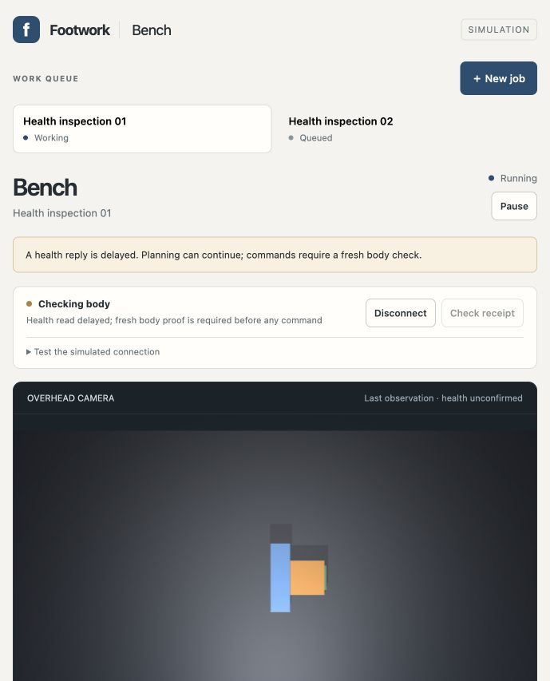
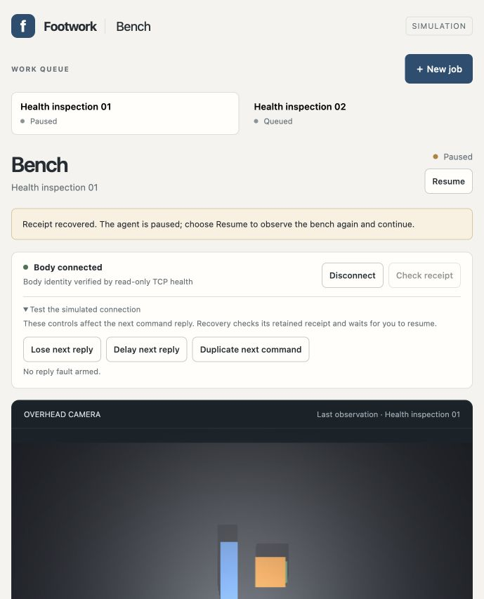

# Delayed health checks without false pauses

Two actual image-guided jobs completed under deliberately delayed health replies with zero unexpected halts or cancelled decisions. The [independent health score](health-qualification-score.json) passed on frozen source `37ebfdb3054b977149d7b60b46254ddd852b749a`. Every one of 83 commands had fresh pinned ready-state proof before its lease and durable admission. The [native/model score](qualification-score.json) separately verified placement, one SQLite measurement per job, contact resets, exact TCP images and proposal/receipt bindings.

The original runtime treated one auxiliary health deadline as body loss and cancelled healthy planning. A real-socket delayed response reproduced that false pause. Repeated slow probes also reproduced six concurrent upstream readers, three per path. The repaired link permits one reader per identity/state path, returns a bounded pending response, discards late results and joins its readers before releasing ownership. The runtime shows **Checking body** for an inconclusive auxiliary read, keeps planning available and requires an independent full status check before every command. Failed authoritative proof still pauses progress; identity, source, boot, lease, freshness, unknown-effect and explicit Pause guards remain in force. Body, client and core policy files were unchanged.

The [diagnosis](diagnosis.json) distinguishes that reproduced mechanism from the earlier incident's unexplained physical scheduling delay. Thirty-two warm sequential pinned reads all succeeded; direct state median was 92.1 ms and linked state median 94.3 ms, with no maximum above 136.7 ms. An isolated scan of 83 copied command records took a median 20.8 ms. Those measurements show real overhead but do not establish why the historical reply crossed its deadline.

| Product check | Retained evidence |
| --- | --- |
| Healthy planning under delayed health | Browser showed Checking body while the active AI continued planning; 173 healthy replies received 1.2-second injected delays |
| Successive jobs | Health inspection 01 used 14 decisions; Health inspection 02 used 13; both completed measurement and contact reset |
| Lost command reply | The command became uncertain and blocked successors; disconnect, reconnect and receipt recovery kept the count at nineteen |
| Recovery | Check receipt read the exact retained outcome without resending; the agent remained paused until explicit Resume obtained fresh evidence |
| Reload | Both completed jobs and all 83 command records remained; no command was added |
| Cleanup | All four owned trial processes exited zero; the relay joined workers after 685 requests, with peak concurrency two; the link retained zero live health readers |

The trial used both delayed paths, then disabled injection for the explicit receipt recovery sequence, then delayed state reads and finally identity reads during the second job. The supplemental [exposure audit](review-audit.json) correlates delayed replies with actual model intervals, checks both paths during both jobs and strengthens proof matching. No naturally slow upstream reply of at least 0.8 seconds occurred in this trial. Artificial delay establishes tolerance to the tested condition, not the cause of the original incident.

[Conformance](conformance.json) passed 117 distinct checks: 26 runtime socket/native cases, 84 core/network/link/HTTP checks and seven harness/scorer cases. Ruff, JavaScript syntax, notebook and whitespace checks passed. The [attempt ledger](attempt-ledger.json) retains the original failing runtime and backlog checks, the intermediate boot-classification failure, and the unretained setup-only interpreter-path error. No measured source changed during the actual model run.

Scoring occurred after the trial stopped and before user handoff. The saved final public state ends at event 284. Restarting the retained roots for handoff advanced the body to boot two and added administrative restart/outage halt events while the host was already paused. These later events remain in the live journal and are distinguished in the supplemental audit; the saved scores describe the stopped trial. Raw prompts, model output and full relay traces remain in ignored storage at `tools/physical-workcell/output/sim12-browser-health-v1/`.

The [live workbench](http://127.0.0.1:51377/) is connected and paused, with both results retained and no active job, model request or uncertain command. [Handoff metadata](handoff.json) records the owned body, persistent relay and workbench PIDs, roots and identities. Delay injection is disabled. The handoff relay has bounded workers and waits for explicit shutdown; it does not inherit the qualification harness's 45-minute trial deadline.

Scope remains same-Mac loopback simulation. Physical hardware, sudden process death during persistence and authenticated cross-machine access remain unqualified. Reproduce with a new trial root using the [runbook](../../../tools/physical-workcell/NETWORK_WORKBENCH.md) and [preregistered experiment](../../docs/experiments/SIM12-workbench-health.md); score after stopping and before restarting that root for handoff.

