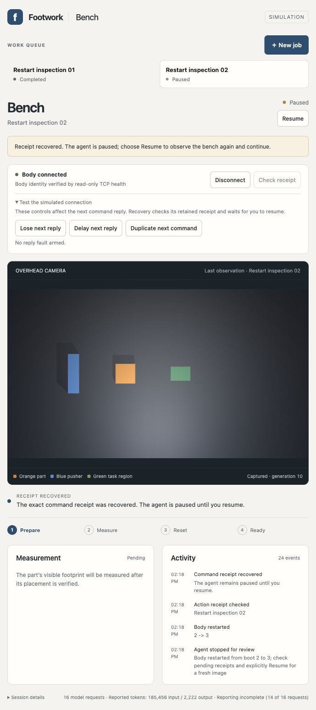

# Mid-job restart recovery

All four graceful process restart cases passed in the actual browser with actual Codex planning. The first model trial ran on frozen source `d7072107d576d7a09643229ae584a3864d2fe0f6`; measured source stayed unchanged. Two jobs completed on one continuous simulated body, with independently checked placement, one SQLite measurement each and contact resets. No uncertain action was resent.

| Interruption | Observed recovery | Independent check |
| --- | --- | --- |
| Workbench while planning | Browser disconnected; owned planner exited; retained job returned paused | Same identity and command records; explicit Resume preceded fresh observation |
| Workbench with uncertain dispatch | Same pending command returned blocked; Check receipt recovered it and left the job paused | Five commands throughout restart, disconnect, reconnect and receipt recovery; one send of the lost command |
| Body while planning | Browser showed Body unavailable; planner cancelled; reboot returned paused | Body identity and motion state retained; epoch advanced from one to two; fresh planning followed Resume |
| Body with uncertain dispatch | Same command stayed unresolved through outage and reboot; historical receipt recovered while paused | Boot-two command recovered during boot three with 46 command records unchanged; one send; fresh observation after Resume |

The [restart score](restart-score.json) passed every boundary and all ten required visible states. The [native/model score](qualification-score.json) bound each exact TCP image to its model input, every applied decision to its typed proposal and lower receipt, and each command to one client send. It ran after all seven owned trial processes had exited. Two cancelled planning calls and a later health cancellation were reaped and withheld; none supplied an action.

| Job | Model requests | Reset generation | Native time at reset | Contact samples |
| --- | ---: | ---: | ---: | ---: |
| Restart inspection 01 | 14 | 10 | 21.680 s | 3,174 |
| Restart inspection 02 | 15 | 20 | 42.630 s | 3,314 |

The run retained 83 command records and 29 model requests, including three cancellations. Browser reload preserved both completed jobs and sent no command. After scoring, both services restarted at the same roots and ports for handoff: [workbench](http://127.0.0.1:51377/), body port 51373. The host is paused, body boot four is verified, both results remain visible, and no job, model request or uncertain command is pending. Owned handoff PIDs and identities are in [handoff.json](handoff.json).

Testing first reproduced a fast-reboot defect: an old decision could acquire a new boot's lease when its outage escaped polling. The runtime now invalidates that decision at either health readback or command admission, requiring explicit Resume and a fresh observation. Restarted and recovered unfinished jobs show Paused. Body/core/client freshness, identity, lease and effect guards were not edited.

Conformance passed 103 checks: nineteen runtime socket cases, eighty core/network/HTTP regressions and four synthetic harness control/ownership checks. Ruff, JavaScript syntax, notebook and diff checks passed. Before-fix failures, an abbreviated-SHA startup refusal before any process or model launch, and the preserved previous product are recorded in [attempt-ledger.json](attempt-ledger.json).

One additional health timeout during reset cancelled a model call and paused the second job. Later read-only health succeeded; explicit Resume used a fresh image and completed the job. Its cause remains unresolved. This is a product reliability limitation retained in [health-timeout-observation.json](health-timeout-observation.json), rather than an excluded attempt. No source changed during that recovery.

Scope is graceful process restarts in same-Mac loopback simulation. Sudden power loss, process kill during native persistence, hardware and authenticated remote access remain untested. Full browser captures and snapshots accompany the compact UI ledger; later ledger entries use main-panel excerpts to stay within its existing 64 KiB bound. Private model prompts and process output remain in ignored trial storage. Reproduce with the [runbook](../../../tools/physical-workcell/NETWORK_WORKBENCH.md) and [preregistered experiment](../../docs/experiments/SIM11-workbench-restarts.md).

